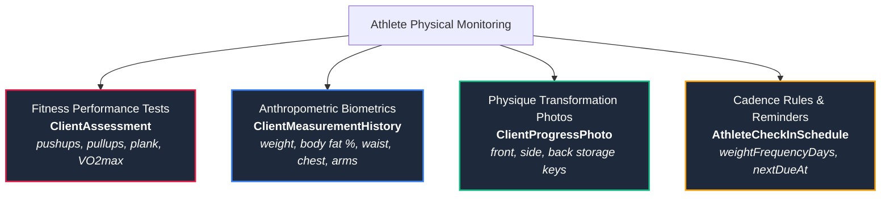
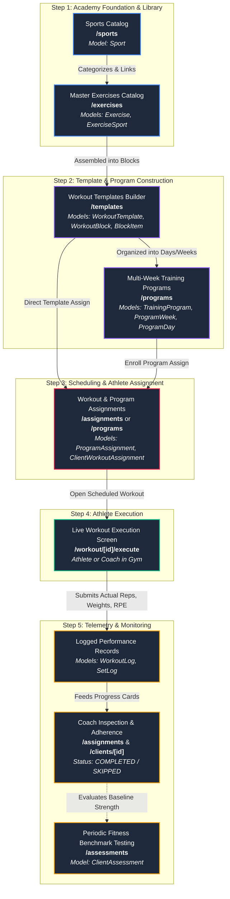

# GX Fitness Academy — Navigation & Screen-Overlap Audit Report
**Document File:** `GX_SCREEN_MAP.md`  
**Date:** November 17, 2026  
**Audit Scope:** Read-only architectural, navigation, and data model overlap audit.  
**Constraint:** Zero code/schema/data changes. Phase 4 not started. Read-only commands only. Concurrent agent awareness noted.

---

## Concurrent Workspace & Git Status Notice

> [!WARNING]
> **CONCURRENT AGENT ACTIVE IN REPOSITORY**  
> Git working tree inspection reveals active unstaged modifications and untracked files in the workspace. In strict adherence to read-only instructions, no build (`next build`/`next dev`), no Prisma engine generation (`prisma generate`), and no git state commands (`git add`/`commit`/`stash`/`checkout`) were executed.
>
> **Unstaged Modified Files:**
> - `package.json`, `package-lock.json`
> - `src/app/api/exercises/[id]/route.ts`
> - `src/app/api/sports/[id]/route.ts`
> - `src/app/api/templates/[id]/route.ts`
> - `src/app/api/templates/route.ts`
> - `src/server/services/exercise.service.ts`
> - `src/server/services/sport.service.ts`
> - `src/server/services/workout.service.ts`
>
> **Untracked Scripts & Files:**
> - `GX_SCREEN_MAP.md` (this audit document)
> - `scripts/inspect-hygiene.ts`
> - `scripts/test-phase3-closure.ts`
> - `scripts/write-retroactive-audit-log.ts`
> - `src/server/services/audit.service.ts`

---

## Verified Database Record Counts (Read-Only Prisma Queries)

The following counts were verified against the live PostgreSQL database via read-only Prisma client execution on November 17, 2026:

| Model / Table Name | Prisma Accessor | Live Verified Count | Practical Audit Meaning |
|---|---|:---:|---|
| `session_calendars` | `prisma.sessionCalendar.count()` | **0** | Confirms root cause: zero group class or PT session slots exist. |
| `session_attendances` | `prisma.sessionAttendance.count()` | **0** | Zero check-in attendance records exist. |
| `client_workout_assignments` | `prisma.clientWorkoutAssignment.count()` | **13** | Exactly 13 workouts assigned across athletes (not "hundreds"). |
| `client_assessments` | `prisma.clientAssessment.count()` | **0** | Zero physical fitness assessment records logged yet. |
| `client_measurement_histories` | `prisma.clientMeasurementHistory.count()` | **1** | Exactly 1 anthropometric body measurement record exists. |
| `client_progress_photos` | `prisma.clientProgressPhoto.count()` | **0** | Zero progress photos uploaded. |
| `athlete_check_in_schedules` | `prisma.athleteCheckInSchedule.count()` | **1** | Exactly 1 check-in cadence schedule configured. |
| `program_assignments` | `prisma.programAssignment.count()` | **1** | Exactly 1 active multi-week program enrollment exists. |

---

## Executive Summary & Key Revelations

1. **The "Missing" Routes Mystery (`/assignments` & `/calendar`):**
   - The routes are **not missing** from the sidebar; they are **labeled counter-intuitively**:
     - In `src/components/layout/Sidebar.tsx` (Line 63), **"Workouts" links directly to `/assignments`**.
     - In `src/components/layout/Sidebar.tsx` (Line 64), **"Classes" links directly to `/calendar`**.
     - In `src/components/layout/Sidebar.tsx` (Line 61), **"Members" links directly to `/clients`**.
   - Because the sidebar labels say "Workouts" and "Classes" while the browser address bar displays `/assignments` and `/calendar`, administrators believed these routes were unlinked orphans.
2. **The "Always Empty" Calendar Mystery:**
   - `/calendar` exclusively queries `GET /api/sessions`, which reads from the `SessionCalendar` (`session_calendars`) table (currently containing **0** rows).
   - **There is no UI button, form, or modal anywhere in the frontend application to create a `SessionCalendar` entry** (calling `POST /api/sessions`).
   - Furthermore, `/calendar` **does not query `ClientWorkoutAssignment`** (where the **13** actual athlete workouts reside). Hence, `/calendar` is permanently blank.
3. **Assessments vs. Assignments vs. Workouts:**
   - **Assessments (`/assessments` & `ClientAssessment`):** Periodic physical fitness benchmark tests (pushups, pullups, plank time, VO2max, 1km run time). Contains no exercise sets or weights.
   - **Assignments (`/assignments` & `ClientWorkoutAssignment`):** Scheduled calendar workout assignments for an athlete on a specific date, derived from a template, a program, or built from scratch.
   - **Workouts / Execution (`/workout/[id]/execute` & `WorkoutLog` / `SetLog`):** Actual live or post-workout execution telemetry recorded by the athlete or coach (weight lifted, reps completed, RPE, skip reasons).
4. **Dead / Legacy API & Models:**
   - `MealPlan` (`meal_plans`) read/written by `/api/nutrition` is **100% dead code**. The application frontend has completely migrated to `NutritionProgram`, `ClientNutritionAssignment`, and `DailyNutritionLog`.
   - `ClientWorkoutAssignmentExercise` is a legacy flat snapshot table that is still actively read by the live execution screen (`/workout/[id]/execute`), because block hierarchy rendering on the execution screen belongs to **Phase 8 (Athlete Experience & Execution)**, not Phase 4.

---

## 1. "Which Screen to Use for X" — Admin Cheat Sheet

To eliminate confusion immediately, this table maps every common administrative task to the exact sidebar label to click, the underlying URL, and the data model affected.

| # | What I Want to Do (English) | ما أريد فعله (عربي) | Sidebar Label to Click | Real URL | Model Affected |
|---|---|---|---|---|---|
| 1 | Assign a workout to an athlete for tomorrow | أريد تكليف رياضي بتمرين غداً | **Workouts** *(Primary)* | `/assignments` | `ClientWorkoutAssignment` |
| 2 | Build a reusable workout blueprint (Supersets/Circuits) | أريد بناء قالب تمرين نموذجي بالمكتبة | **Templates** *(Management)* | `/templates` | `WorkoutTemplate`, `WorkoutBlock` |
| 3 | Create a multi-week periodized training roadmap | أريد تصميم برنامج تدريبي لعدة أسابيع | **Programs** *(Primary)* | `/programs` | `TrainingProgram`, `ProgramWeek` |
| 4 | Enroll an athlete into a multi-week training program | أريد إلحاق لاعب ببرنامج تدريبي ممتد | **Programs** *(Assign modal)* or **Workouts** *(Mode C)* | `/programs` or `/assignments` | `ProgramAssignment`, bulk `ClientWorkoutAssignment` |
| 5 | View the list of all athletes, their sport, and assigned coach | أريد استعراض قائمة الرياضيين والمدرب المسؤول | **Members** *(Primary)* | `/clients` | `ClientProfile`, `ClientCoachAssignment` |
| 6 | Open an athlete's complete file (measurements, medical, photos) | أريد فتح الملف الشامل للاعب (القياسات، الموانع، الصور) | Click **Members** $\rightarrow$ Click athlete row | `/clients/[id]` | `ClientProfile` (all sub-tabs) |
| 7 | Record an athlete's physical fitness test (pushups, VO2max) | أريد تسجيل اختبار اللياقة والقدرة البدنية | **Assessments** *(Management)* or athlete profile | `/assessments` or `/clients/[id]#assessments` | `ClientAssessment` |
| 8 | Record athlete scale weight, body fat %, and tape circumferences | أريد تسجيل وزن اللاعب ونسبة الدهون ومقاسات الجسم | Click **Members** $\rightarrow$ Tab **Measurements** | `/clients/[id]#measurements` | `ClientMeasurementHistory` |
| 9 | Upload private front/side/back progress photos | أريد رفع صور التطور البدني الخاصة باللاعب | Click **Members** $\rightarrow$ Tab **Photos** | `/clients/[id]#photos` | `ClientProgressPhoto` |
| 10 | Configure check-in frequency (e.g. weigh-in every 7 days) | أريد تحديد مواعيد المتابعة الدورية للوزن والقياسات | Click **Members** $\rightarrow$ Tab **Check-Ins** | `/clients/[id]#checkins` | `AthleteCheckInSchedule` |
| 11 | Build a nutrition program or assign daily calories/macros | أريد إعداد خطة غذائية وتعيين السعرات والماكروز | **Nutrition** *(Primary)* | `/nutrition` | `NutritionProgram`, `ClientNutritionAssignment` |
| 12 | Track athlete daily food logs and adherence | أريد متابعة التزام الرياضي بالوجبات اليومية | **Nutrition** *(Monitoring tab)* | `/nutrition` | `DailyNutritionLog` |
| 13 | Mark attendance for a scheduled training session | أريد تسجيل حضور وغياب الرياضيين في الحصة | **Attendance** *(Management)* | `/attendance` | `SessionAttendance` |
| 14 | Add a new exercise to the academy exercise bank | أريد إضافة حركة أو تمرين جديد لدليل التمارين | **Exercises** *(Management)* | `/exercises` | `Exercise`, `ExerciseSport` |
| 15 | Add or manage academy sports (Boxing, Swimming, etc.) | أريد إدارة الرياضات المعتمدة بالأكاديمية | **Sports** *(Management)* | `/sports` | `Sport` |
| 16 | View the weekly schedule of classes/sessions | أريد استعراض جدول الحصص الأسبوعي | **Classes** *(Primary)* | `/calendar` | `SessionCalendar` *(empty; requires expansion)* |
| 17 | Create a new user account (Coach, Admin) or send reset link | أريد إنشاء حساب جديد أو توليد رابط كلمة مرور | **Users** *(Management)* | `/users` | `User`, `CoachProfile`, `PasswordResetToken` |
| 18 | Edit public packages and pricing on the landing page | أريد تعديل باقات وأسعار الاشتراك على الموقع العام | **Public Packages** *(Website CMS)* | `/admin-public/packages` | `PublicPackage` |
| 19 | Upload gym gallery facility photos for the website | أريد رفع صور لمعرض صور الموقع العام | **CMS Overview** $\rightarrow$ Card **Gallery & Media** | `/admin-public/gallery` | `GalleryImage` *(Orphan from sidebar)* |
| 20 | Inspect security logs of who created or modified data | أريد فحص سجل العمليات والرقابة الأمنية | **Audit Logs** *(Management)* | `/audit-logs` | `AuditLog` |

---

### Sidebar Label vs. Real URL Mapping

| Current Sidebar Label | Sidebar Section | Actual URL Route | Why This Label Confuses the Administrator |
|---|---|---|---|
| **Workouts** | Primary Navigation | `/assignments` | The label is "Workouts" but the URL is `/assignments`. In reality, it is a scheduled calendar of assignments. |
| **Classes** | Primary Navigation | `/calendar` | The label is "Classes" but the URL is `/calendar`. Users expect an all-inclusive calendar, but it only queries classes. |
| **Members** | Primary Navigation | `/clients` | The label is "Members" while code calls them clients/athletes. |
| **Templates** | Management Tools | `/templates` | Placed under "Management Tools" rather than alongside Programs and Workouts. |
| **Sports** | Management Tools | `/sports` | Placed under "Management Tools" rather than at the top of the training hierarchy. |
| **Assessments** | Management Tools | `/assessments` | Sounds like "assignments", leading users to think it's where workouts are assigned. |
| *(Missing from Sidebar)* | Website CMS | `/admin-public/gallery` | Fully functional gallery manager, but absent from `cmsAdminNav` in `Sidebar.tsx`. |

---

## 2. Overlap Section: Assessments vs. Measurements vs. Check-Ins

Administrators frequently ask: *"Where do I record an athlete's physical metrics, and how do assessments differ from measurements and check-ins?"*



### Side-by-Side Architectural Comparison

| Dimension | `ClientAssessment` | `ClientMeasurementHistory` | `AthleteCheckInSchedule` | `ClientProgressPhoto` |
|---|---|---|---|---|
| **Core Concept** | **اختبارات الأداء واللياقة البدنية**<br>*Functional Athletic Performance* | **القياسات الجسمانية ونسب الدهون**<br>*Anthropometrics & Body Composition* | **قواعد وتكرارات المتابعة الدورية**<br>*Compliance Cadence & Scheduling* | **صور التطور البدني الخاصة**<br>*Private Visual Progress Photos* |
| **Live Database Count** | **0** rows | **1** row | **1** row | **0** rows |
| **Data Fields Stored** | `pushupsCount`, `pullupsCount`, `plankSeconds`, `runningKmTimeSec`, `flexibilityScore`, `vo2Max`, `coachNotes`, `date`, `title` | `weightKg`, `heightCm`, `bmi`, `bodyFatPercentage`, `muscleMassKg`, `waistCm`, `chestCm`, `armsCm`, `thighCm`, `notes`, `date` | `weightFrequencyDays`, `measurementFrequencyDays`, `photoFrequencyDays`, `lastWeightAt`, `nextWeightDueAt`, `notes` | `frontImageUrl`, `sideImageUrl`, `backImageUrl`, `frontStorageKey`, `weightAtTime`, `notes`, `date` |
| **Which Screens Write It** | 1. `/assessments` (Add modal)<br>2. `/clients/[id]#assessments` (Modal) | `/clients/[id]#measurements` (Add Measurement modal) | `/clients/[id]#checkins` (Schedule Config form) | `/clients/[id]#photos` (Upload Photo modal) |
| **API Endpoints** | `POST /api/assessments` | `POST /api/clients/[id]/measurements` | `POST /api/clients/[id]/check-in-schedule` | `POST /api/clients/[id]/photos` |
| **Who Enters the Data** | Coach during quarterly/monthly fitness tests | Coach during physical check-in weigh-in | Coach setting up athlete profile rules | Athlete or Coach uploading camera shots |
| **Phase Ownership** | Baseline (Phase 1–2) | Phase 7 (Athlete Profile & Check-ins) | Phase 7 (Athlete Profile & Check-ins) | Phase 7 (Athlete Profile & Check-ins) |

### Recommended Domain Boundary Proposal *(For Owner Approval)*
1. **`ClientAssessment` (Performance Boundary):** Strictly dedicated to functional capacity, fitness benchmarks, and athletic conditioning (e.g. max pushups, pullup endurance, 1km running time, plank hold time, VO2 max). It should **never** store scale weight or body fat %.
2. **`ClientMeasurementHistory` (Biometric Boundary):** Dedicated exclusively to body composition (scale weight, body fat %, muscle mass kg, tape circumferences of waist/chest/arms/thighs).
3. **`AthleteCheckInSchedule` (Cadence Boundary):** Automation rules governing when the athlete owes their next weigh-in, measurement check, or progress photo.
4. **`ClientProgressPhoto` (Visual Boundary):** Private, authenticated visual physique transformation logs tagged with date and weight.

---

## 3. Screen Inventory (All 29 Routes under `src/app`)

Every route in `src/app` is cataloged below with verified code evidence.

### 3.1 Primary Navigation Screens (Sidebar Top Section)

| # | Route | Sidebar Label | Purpose (AR / EN) | Who Can Open | API Routes Called | Prisma Models Read / Written | Navigation Status |
|---|---|---|---|---|---|---|---|
| 1 | `/dashboard` | **Dashboard** | لوحة تحكم وإحصائيات عامة للأكاديمية والمدرب والرياضي<br>*High-level performance, schedule, and KPI overview.* | `ADMIN`, `HEAD_COACH`, `COACH`, `CLIENT` (Role-specific view) | `GET /api/dashboard` | **Read:** `ClientProfile`, `CoachProfile`, `Exercise`, `WorkoutTemplate`, `ClientWorkoutAssignment`, `SessionCalendar`, `ProgramAssignment`, `ClientNutritionAssignment`, `AthleteCheckInSchedule`, `ClientAssessment`<br>**Written:** None | Linked (Primary item 1) |
| 2 | `/clients` | **Members** | دليل وإدارة ملفات المشتركين والرياضيين والمدربين المشرفين<br>*Athlete and member directory, status tracking, and coach assignment.* | `ADMIN`, `HEAD_COACH`, `COACH` | `GET /api/clients`, `GET /api/coaches`, `GET /api/sports`, `POST /api/clients`, `POST /api/clients/[id]/coaches` | **Read:** `ClientProfile`, `User`, `Sport`, `CoachProfile`, `ClientCoachAssignment`<br>**Written:** `ClientProfile`, `User`, `ClientCoachAssignment` | Linked (Primary item 2) |
| 3 | `/programs` | **Programs** | تصميم وإدارة البرامج التدريبية الممتدة لعدة أسابيع وتعيينها للرياضيين<br>*Multi-week periodized training program builder and assignment manager.* | `ADMIN`, `HEAD_COACH`, `COACH` (CLIENT view redirects/instructs to `/assignments`) | `GET /api/programs`, `POST /api/programs`, `GET /api/templates`, `GET /api/sports`, `GET /api/clients`, `GET /api/nutrition-programs`, `PATCH /api/programs/[id]`, `DELETE /api/programs/[id]` | **Read:** `TrainingProgram`, `ProgramWeek`, `ProgramDay`, `ProgramWorkout`, `WorkoutTemplate`, `Sport`, `NutritionProgram`, `ProgramAssignment`<br>**Written:** `TrainingProgram`, `ProgramWeek`, `ProgramDay`, `ProgramWorkout`, `ProgramAssignment`, `ClientWorkoutAssignment` | Linked (Primary item 3) |
| 4 | `/assignments` | **Workouts** *(Admin)* / **My Workouts** *(Athlete)* | جدولة وتكليف التمارين اليومية للرياضيين ومتابعة حالة الإنجاز<br>*Daily workout assignment scheduler, status monitor, and program enrollment.* | `ADMIN`, `HEAD_COACH`, `COACH`, `CLIENT` | `GET /api/workouts`, `POST /api/workouts`, `GET /api/clients`, `GET /api/coaches`, `GET /api/exercises`, `GET /api/programs`, `PATCH /api/workouts/[id]`, `DELETE /api/workouts/[id]` | **Read:** `ClientWorkoutAssignment` (13 rows), `ClientWorkoutAssignmentExercise`, `WorkoutTemplate`, `TrainingProgram`, `WorkoutLog`, `ClientProfile`, `CoachProfile`<br>**Written:** `ClientWorkoutAssignment`, `ClientWorkoutAssignmentExercise`, `AssignmentBlock`, `AssignmentBlockItem`, `ProgramAssignment`, `WorkoutLog` | Linked (Primary item 4) |
| 5 | `/calendar` | **Classes** | عرض جدول الحصص التدريبية الجماعية والجلسات الخاصة<br>*Training schedule for group classes and 1-on-1 personal training.* | `ADMIN`, `HEAD_COACH`, `COACH`, `CLIENT` | `GET /api/sessions` | **Read:** `SessionCalendar` (0 rows), `CoachProfile`, `Sport`, `SessionAttendance` (0 rows), `ClientProfile`<br>**Written:** None (Read-only UI) | Linked (Primary item 5) — **Permanently empty due to data source disconnect** |
| 6 | `/coaches` | **Coaches** | إدارة طاقم المدربين والتخصصات وتعيين الرياضيين تحت إشرافهم<br>*Coach staff roster, specialty management, and athlete-coach linking.* | `ADMIN`, `HEAD_COACH`, `COACH` | `GET /api/coaches`, `POST /api/coaches`, `GET /api/sports`, `GET /api/clients`, `PATCH /api/coaches/[id]`, `DELETE /api/coaches/[id]`, `POST /api/clients/[id]/coaches` | **Read:** `CoachProfile`, `User`, `Sport`, `ClientProfile`, `ClientCoachAssignment`, `PublicCoachProfile`<br>**Written:** `CoachProfile`, `User`, `ClientCoachAssignment`, `PublicCoachProfile` | Linked (Primary item 6) |
| 7 | `/nutrition` | **Nutrition** *(Admin)* / **My Meal Plan** *(Athlete)* | بناء مكتبة البرامج الغذائية وتعيين الماكروز وتتبع الالتزام اليومي<br>*Nutrition program library, athlete macro assignment, and daily meal logging.* | `ADMIN`, `HEAD_COACH`, `COACH`, `CLIENT` | `GET /api/nutrition-programs`, `POST /api/nutrition-programs`, `GET /api/nutrition/assignments`, `POST /api/nutrition/assignments`, `GET /api/nutrition/daily-logs`, `POST /api/nutrition/daily-logs`, `PATCH /api/nutrition/daily-logs/[id]`, `GET /api/clients`, `GET /api/coaches` | **Read:** `NutritionProgram`, `ClientNutritionAssignment`, `DailyNutritionLog`, `ClientProfile`, `CoachProfile`<br>**Written:** `NutritionProgram`, `ClientNutritionAssignment`, `DailyNutritionLog` | Linked (Primary item 7) |
| 8 | `/reports` | **Reports** | لوحة تقارير وإحصائيات الأداء ومعدلات الحضور الرياضي<br>*Performance metrics, attendance rates, and sports distribution analytics.* | `ADMIN`, `HEAD_COACH`, `COACH` | `GET /api/dashboard` | **Read:** Counts from `ClientProfile`, `WorkoutTemplate`, `ClientWorkoutAssignment`, `SessionCalendar`<br>**Written:** None | Linked (Primary item 8) — *Placeholder screen with 0-value mock charts* |
| 9 | `/settings` | **Settings** | تخصيص مظهر التطبيق (داكن/فاتح)، لغة الواجهة، ووحدات القياس<br>*UI theme switcher (dark/light), locale (AR/EN), and measurement units.* | `ADMIN`, `HEAD_COACH`, `COACH`, `CLIENT` | None (Uses client-side React Context: `ThemeContext`, `LanguageContext`) | **Read:** None (Local Storage)<br>**Written:** None | Linked (Primary item 9) |

---

### 3.2 Management Tools Screens (Sidebar Middle Section)

| # | Route | Sidebar Label | Purpose (AR / EN) | Who Can Open | API Routes Called | Prisma Models Read / Written | Navigation Status |
|---|---|---|---|---|---|---|---|
| 10 | `/users` | **Users** | إدارة حسابات جميع مستخدمي النظام والصلاحيات وتوليد روابط استعادة كلمة المرور<br>*System user administration, role assignment, password reset link generation.* | `ADMIN`, `HEAD_COACH` | `GET /api/users`, `POST /api/users`, `PATCH /api/users/[id]`, `DELETE /api/users/[id]`, `POST /api/auth/reset-link` | **Read:** `User`, `CoachProfile`, `ClientProfile`, `AuditLog`<br>**Written:** `User`, `CoachProfile`, `ClientProfile`, `PasswordResetToken`, `AuditLog` | Linked (Management item 1) |
| 11 | `/templates` | **Templates** | بناء مكتبة قوالب التمارين النموذجية مع مجموعات السوبرسيت والسيركت وتعيينها للرياضيين<br>*Workout template library builder with block hierarchy (singles/supersets/circuits) & assignment.* | `ADMIN`, `HEAD_COACH`, `COACH` | `GET /api/templates`, `POST /api/templates`, `PATCH /api/templates/[id]`, `DELETE /api/templates/[id]`, `GET /api/exercises`, `GET /api/sports`, `GET /api/clients`, `POST /api/workouts` | **Read:** `WorkoutTemplate`, `WorkoutBlock`, `BlockItem`, `Exercise`, `Sport`, `ClientProfile`<br>**Written:** `WorkoutTemplate`, `WorkoutBlock`, `BlockItem`, `WorkoutTemplateExercise` (dual-write), `ClientWorkoutAssignment` | Linked (Management item 2) |
| 12 | `/exercises` | **Exercises** | إدارة الدليل الشامل للحركات والتمارين الرياضية وموانع الإصابات والفيديوهات<br>*Master exercise catalog with biomechanics, muscle targets, contraindications & videos.* | `ADMIN`, `HEAD_COACH`, `COACH` | `GET /api/exercises`, `POST /api/exercises`, `PATCH /api/exercises/[id]`, `DELETE /api/exercises/[id]`, `GET /api/exercises/meta`, `GET /api/sports` | **Read:** `Exercise`, `ExerciseSport`, `MuscleGroup`, `Equipment`, `Sport`<br>**Written:** `Exercise`, `ExerciseSport` | Linked (Management item 3) |
| 13 | `/sports` | **Sports** | تهيئة الرياضات المعتمدة بالأكاديمية (ملاكمة، كمال أجسام، سباحة، إلخ)<br>*Academy sports catalog and discipline definitions.* | `ADMIN`, `HEAD_COACH`, `COACH` | `GET /api/sports`, `POST /api/sports`, `PATCH /api/sports/[id]`, `DELETE /api/sports/[id]` | **Read:** `Sport`<br>**Written:** `Sport` | Linked (Management item 4) |
| 14 | `/assessments` | **Assessments** *(Admin)* / **My Assessments** *(Athlete)* | تسجيل ومتابعة اختبارات اللياقة البدنية والقياسات الوظيفية الدورية للرياضي<br>*Physical performance testing, fitness benchmark evaluations, and progress scoring.* | `ADMIN`, `HEAD_COACH`, `COACH`, `CLIENT` | `GET /api/assessments`, `POST /api/assessments`, `PATCH /api/assessments/[id]`, `DELETE /api/assessments/[id]`, `GET /api/clients` | **Read:** `ClientAssessment` (0 rows), `ClientProfile`, `CoachProfile`<br>**Written:** `ClientAssessment` | Linked (Management item 5) |
| 15 | `/attendance` | **Attendance** | تسجيل وتتبع حضور وغياب الرياضيين في الحصص التدريبية<br>*Session check-in, late arrival marking, excused absence recording.* | `ADMIN`, `HEAD_COACH`, `COACH` | `GET /api/sessions`, `PATCH /api/sessions` | **Read:** `SessionCalendar` (0 rows), `SessionAttendance` (0 rows), `ClientProfile`, `CoachProfile`<br>**Written:** `SessionAttendance` | Linked (Management item 6) — *Empty until sessions are created* |
| 16 | `/memberships` | **Memberships** *(Admin)* / **My Membership** *(Athlete)* | استعراض باقات العضوية وسجلات اشتراكات ودفعات الرياضيين<br>*Membership subscription packages, client billing plans, payment status.* | `ADMIN`, `HEAD_COACH`, `COACH`, `CLIENT` | `GET /api/memberships`, `POST /api/memberships` | **Read:** `Membership`, `PublicPackage`, `ClientProfile`<br>**Written:** `Membership` | Linked (Management item 7) |
| 17 | `/audit-logs` | **Audit Logs** | سجل الرقابة والتدقيق الأمني لجميع العمليات الحساسة والتعديلات في النظام<br>*Enterprise audit trail tracking logins, mutations, assignments, and user events.* | `ADMIN` | `GET /api/audit-logs` | **Read:** `AuditLog`, `User`<br>**Written:** None (Read-only viewer) | Linked (Management item 8) |

---

### 3.3 Website CMS Screens (Sidebar Bottom Section)

| # | Route | Sidebar Label | Purpose (AR / EN) | Who Can Open | API Routes Called | Prisma Models Read / Written | Navigation Status |
|---|---|---|---|---|---|---|---|
| 18 | `/admin-public` | **CMS Overview** | لوحة التحكم وإحصائيات إدارة محتوى الموقع التسويقي العام للأكاديمية<br>*Public landing page CMS dashboard and metrics overview.* | `ADMIN`, `HEAD_COACH` | `GET /api/admin-public/packages`, `GET /api/admin-public/championships`, `GET /api/admin-public/offers`, `GET /api/admin-public/coaches`, `GET /api/admin-public/gallery` | **Read:** `PublicPackage`, `Championship`, `PublicOffer`, `CoachProfile`, `PublicCoachProfile`, `GalleryImage`<br>**Written:** None | Linked (CMS item 1) |
| 19 | `/admin-public/packages` | **Public Packages** | إدارة باقات العضوية المعروضة على الصفحة الرئيسية وأسعارها ومميزاتها<br>*Public membership pricing tiers, benefits, and featured flags.* | `ADMIN`, `HEAD_COACH` | `GET /api/admin-public/packages`, `POST /api/admin-public/packages`, `PATCH /api/admin-public/packages/[id]`, `DELETE /api/admin-public/packages/[id]` | **Read:** `PublicPackage`<br>**Written:** `PublicPackage` | Linked (CMS item 2) |
| 20 | `/admin-public/championships` | **Championships** | نشر سجل بطولات الأكاديمية والميداليات والمراكز الشرفية<br>*Tournament records, medals, podium finishes, and championship media.* | `ADMIN`, `HEAD_COACH` | `GET /api/admin-public/championships`, `POST /api/admin-public/championships`, `PATCH /api/admin-public/championships/[id]`, `DELETE /api/admin-public/championships/[id]` | **Read:** `Championship`<br>**Written:** `Championship` | Linked (CMS item 3) |
| 21 | `/admin-public/offers` | **Offers** | إعداد العروض الترويجية والخصومات الموسمية المعروضة للجمهور<br>*Promotional offers, seasonal discount rates, and WhatsApp campaign links.* | `ADMIN`, `HEAD_COACH` | `GET /api/admin-public/offers`, `POST /api/admin-public/offers`, `PATCH /api/admin-public/offers/[id]`, `DELETE /api/admin-public/offers/[id]`, `GET /api/admin-public/packages` | **Read:** `PublicOffer`, `PublicPackage`<br>**Written:** `PublicOffer` | Linked (CMS item 4) |
| 22 | `/admin-public/coaches` | **Public Coaches** | تحديد المدربين الظاهرين على الموقع العام وتعديل المسميات التعريفية<br>*Public coach visibility toggles, bios, and display sequence.* | `ADMIN`, `HEAD_COACH` | `GET /api/admin-public/coaches`, `PATCH /api/admin-public/coaches/[id]` | **Read:** `CoachProfile`, `PublicCoachProfile`, `User`<br>**Written:** `PublicCoachProfile` | Linked (CMS item 5) |
| 23 | `/admin-public/settings` | **Website Settings** | تهيئة أرقام واتساب وبيانات التواصل والروابط الاجتماعية وساعات العمل<br>*Academy public contact info, WhatsApp number, tagline, and socials.* | `ADMIN`, `HEAD_COACH` | `GET /api/admin-public/settings`, `POST /api/admin-public/settings` | **Read:** `AcademySetting`<br>**Written:** `AcademySetting` | Linked (CMS item 6) |

---

### 3.4 Unlinked & Non-Sidebar Routes (Under `src/app`)

| # | Route | Purpose (AR / EN) | Who Can Open | API Routes Called | Prisma Models Read / Written | How It Is Reached (Links / Orphan) |
|---|---|---|---|---|---|---|
| 24 | `/` (`src/app/page.tsx`) | الصفحة الرئيسية التسويقية العامة للأكاديمية والتعريف بالخدمات<br>*Public landing page showcasing sports, coaches, packages, and championships.* | Public (Guests). Authenticated sessions redirect to `/dashboard`. | Direct server-side Prisma fetch | **Read:** `AcademySetting`, `Sport`, `CoachProfile`, `PublicCoachProfile`, `PublicPackage`, `Championship`, `PublicOffer`, `GalleryImage`<br>**Written:** None | Root URL. Reached from browser or logo links. |
| 25 | `/login` (`src/app/login/page.tsx`) | صفحة تسجيل الدخول لبوابة الأكاديمية بالبريد الإلكتروني وكلمة المرور<br>*User authentication portal with role-based session initialization.* | Public / Unauthenticated users | `POST /api/auth/login` | **Read:** `User`, `CoachProfile`, `ClientProfile`<br>**Written:** `Session`, `AuditLog` | Reached from landing page header "Portal Login" or unauthorized redirects. |
| 26 | `/reset-password` (`src/app/reset-password/page.tsx`) | صفحة إعادة تعيين كلمة المرور عبر الرمز الآمن<br>*Token-based secure password reset execution.* | Public with valid `?token=...` query param | `POST /api/auth/reset-password` | **Read:** `PasswordResetToken`, `User`<br>**Written:** `User.passwordHash`, `PasswordResetToken.usedAt`, `AuditLog` | Reached via WhatsApp/email reset link generated by Admin in `/users`. |
| 27 | `/clients/[id]` (`src/app/clients/[id]/page.tsx`) | الملف التفصيلي الشامل للرياضي (القياسات، الموانع، البرامج، التمارين، التغذية، الصور)<br>*Deep athlete profile containing all 11 sub-tabs (check-ins, program, workouts, nutrition, medical, etc.).* | `ADMIN`, `HEAD_COACH`, `COACH` (Assigned), `CLIENT` (Self-profile) | `GET /api/clients/[id]`, `POST /api/clients/[id]/measurements`, `POST /api/clients/[id]/medical`, `POST /api/clients/[id]/coaches`, `POST /api/clients/[id]/notes`, `POST /api/clients/[id]/photos`, `POST /api/assessments`, `POST /api/nutrition/daily-logs` | **Read:** `ClientProfile`, `ClientMeasurementHistory`, `ClientMedicalRestriction`, `ClientGoal`, `ClientProgressPhoto`, `ClientAssessment`, `ClientWorkoutAssignment`, `ProgramAssignment`, `ClientNutritionAssignment`, `AthleteCheckInSchedule`, `ClientNote`<br>**Written:** All client sub-models | **Linked from:** `/clients` row clicks, `/dashboard` athlete list, `/coaches` assigned athletes, and in Athlete Sidebar as "My Profile" (`/clients/${user.id}`). |
| 28 | `/workout/[id]/execute` (`src/app/workout/[id]/execute/page.tsx`) | شاشة تتبع وتنفيذ التمرين الرياضي المباشر وتسجيل الأوزان والعدات والملاحظات<br>*Live workout execution tracker with timers, set-by-set actual logging, and completion flow.* | `ADMIN`, `HEAD_COACH`, `COACH`, `CLIENT` (Assigned athlete) | `GET /api/workouts/[id]`, `PATCH /api/workouts/[id]` | **Read:** `ClientWorkoutAssignment`, `ClientWorkoutAssignmentExercise`, `WorkoutTemplate`, `WorkoutLog`, `WorkoutExerciseLog`, `SetLog`<br>**Written:** `ClientWorkoutAssignment.status`, `WorkoutLog`, `WorkoutExerciseLog`, `SetLog` | **Linked from:** `/assignments` ("Execute Workout" button), `/clients/[id]` WorkoutsTab, and `AthleteDashboard`. |
| 29 | `/admin-public/gallery` (`src/app/admin-public/gallery/page.tsx`) | إدارة معرض الصور العام للأكاديمية والوسائط المرئية<br>*Public gym gallery media manager (image URLs, captions, display order).* | `ADMIN`, `HEAD_COACH` | `GET /api/admin-public/gallery`, `POST /api/admin-public/gallery`, `DELETE /api/admin-public/gallery/[id]` | **Read:** `GalleryImage`<br>**Written:** `GalleryImage` | **ORPHAN FROM SIDEBAR!** It is missing from `cmsAdminNav` in `Sidebar.tsx`. It can only be opened by clicking the "Gallery & Media" card inside `/admin-public`. |
| 30 | *(Clarification on `/my-*`)* | **No physical `/my-*` route folders exist on disk.** | N/A | N/A | N/A | The Athlete navigation uses labels prefixed with "My" (e.g. "My Workouts", "My Assessments", "My Meal Plan") which point to `/assignments`, `/assessments`, and `/nutrition`. |

---

## 4. Extended Duplicate Operations Matrix

This matrix maps every business operation that can be executed in multiple screens, identifying target Prisma models and evaluating data consistency risk.

| # | Operation | Screens Where It Can Be Done | Target Prisma Models Written | Consistency & Risk Verdict |
|---|---|---|---|---|
| 1 | **Assign Workout Template to Athlete** | 1. `/templates` (Assign Template modal)<br>2. `/assignments` (Assign Workout modal, mode=`TEMPLATE`) | `ClientWorkoutAssignment`, `ClientWorkoutAssignmentExercise`, `AssignmentBlock`, `AssignmentBlockItem` | **Safe & Identical:** Both call `POST /api/workouts` with identical block and exercise snapshot logic. Redundant entry points disorient the user. |
| 2 | **Assign Individual Exercises from Scratch (Mode A)** | 1. `/assignments` (Assign Workout modal, mode=`INDIVIDUAL`)<br>2. *(Redirected from)* `/clients/[id]#workouts` | `ClientWorkoutAssignment`, `ClientWorkoutAssignmentExercise`, `AssignmentBlock`, `AssignmentBlockItem` | **Safe:** Sole authoring screen is `/assignments`; the button on athlete profile acts as a deep link pre-filling athlete ID. |
| 3 | **Assign Training Program to Athlete** | 1. `/programs` (Assign Program modal)<br>2. `/assignments` (Assign Workout modal, mode=`PROGRAM`)<br>3. `/clients/[id]#program` (Redirect button) | `ProgramAssignment`, bulk `ClientWorkoutAssignment` | **Safe & Identical:** Both screens invoke `POST /api/programs` with start date and rest day handling. Redundant entry points. |
| 4 | **Assign Coach to Athlete (or Athlete to Coach)** | 1. `/clients` (Quick Assign Coach modal)<br>2. `/clients/[id]#coaches` (Assign Coach modal)<br>3. `/coaches` (Assign Athlete to Coach modal) | `ClientCoachAssignment` (`client_coach_assignments`) | **Triple Overlap:** All 3 call `POST /api/clients/[id]/coaches`. Valid business logic, but spread across 3 separate menus. |
| 5 | **Create New Athlete / Client Profile** | 1. `/clients` (Add Client modal)<br>2. `/users` (Add User modal with `role="CLIENT"`) | `User`, `ClientProfile` | **Minor Divergence:** `/clients` collects height, weight, preferred sport, and coach assignment directly on creation. `/users` collects basic credentials and height/weight only. |
| 6 | **Create New Coach Profile** | 1. `/coaches` (Add Coach modal)<br>2. `/users` (Add User modal with `role="COACH"`) | `User`, `CoachProfile` | **Minor Divergence:** `/coaches` collects bio, specialties, and years of experience. `/users` provides a generic modal. |
| 7 | **Create / Record Physical Assessment** | 1. `/assessments` (Add Assessment modal)<br>2. `/clients/[id]#assessments` (AssessmentsTab modal) | `ClientAssessment` (`client_assessments`) | **Safe & Identical:** Both call `POST /api/assessments` with the exact same metric fields. |
| 8 | **Record Anthropometric Body Measurements** | 1. `/clients/[id]#measurements` (Add Measurement modal) | `ClientMeasurementHistory` (`client_measurement_histories`) | **Single Source:** Only available in the athlete profile dossier. Currently contains 1 live row. |
| 9 | **Upload Progress Photos** | 1. `/clients/[id]#photos` (Upload Photo modal) | `ClientProgressPhoto` (`client_progress_photos`) | **Single Source:** Only available in the athlete profile dossier. |
| 10 | **Schedule Training Session / Class** | **Nowhere in the frontend UI!** *(Backend API only: `POST /api/sessions`)* | `SessionCalendar` (`session_calendars`) | **Critical Missing UI:** Explains why `session_calendars` has 0 rows. No screen allows creating a session. |
| 11 | **Mark Attendance** | 1. `/attendance` (Interactive status toggles)<br>2. `/calendar` (Read-only list, no edit toggles) | `SessionAttendance` (`session_attendances`) | **Single Interactive Screen:** Only `/attendance` calls `PATCH /api/sessions`. Currently 0 rows exist. |
| 12 | **View Athlete Progress & History** | 1. `/clients/[id]` (Across 11 sub-tabs)<br>2. `/assignments` (Global workout status filter)<br>3. `/dashboard` (Athlete Portal mode)<br>4. `/assessments` (Fitness score trend comparison)<br>5. `/reports` (High-level charts) | Reads `ClientProfile`, `WorkoutLog`, `ClientAssessment`, `ClientMeasurementHistory` | **Safe Read-Only:** Multiple views tailored to specific contexts (individual dossier vs. academy-wide oversight). |
| 13 | **Assign Nutrition Plan to Athlete** | 1. `/nutrition` (under "assignments" tab)<br>2. `/programs` (attached during program assignment) | `ClientNutritionAssignment` (`client_nutrition_assignments`) | **Safe:** Program assignment inherits the program's linked nutrition plan, while `/nutrition` allows manual custom override. |
| 14 | **Toggle Public Coach Profile (Website)** | 1. `/admin-public/coaches` (Public Coach CMS)<br>2. `/coaches` (Coach roster list & edit modal) | `PublicCoachProfile` (`public_coach_profiles`) | **Double Overlap:** Managing public landing page flags can be done in both staff management and CMS. |

---

## 5. End-to-End Data Flow Diagram



---

## 6. The Calendar Breakdown: Root Cause & Fix

### 6.1 Trace of Data Flow to Render
1. **Frontend Component:** `src/app/calendar/page.tsx`
   - Component state: `const [sessions, setSessions] = useState<SessionCalendar[]>([]);`
   - In `useEffect()` (Line 18): Executes `fetch("/api/sessions")`.
   - In JSX render (Lines 48–51):
     ```tsx
     sessions.length === 0 ? (
       <div>No scheduled sessions found in the calendar.</div>
     ) : (
       <div className="grid grid-cols-1 md:grid-cols-2 gap-5">
         {sessions.map((sess) => ( ... ))}
       </div>
     )
     ```
2. **API Route:** `src/app/api/sessions/route.ts` (Line 14)
   - Executes: `const sessions = await sessionService.getSessions();`
3. **Database Service:** `src/server/services/session.service.ts` (Lines 8–33)
   - Executes query:
     ```ts
     return await prisma.sessionCalendar.findMany({
       include: {
         coach: { include: { user: true } },
         sport: true,
         attendances: { include: { client: { include: { user: true } } } }
       },
       orderBy: { startTime: "asc" }
     });
     ```
4. **Prisma Model:** `SessionCalendar` (`session_calendars`).

### 6.2 Root Cause Analysis
1. **Root Cause 1 (Zero Rows & Missing Creation UI):**
   - The database table `session_calendars` contains exactly **0** rows.
   - Codebase search reveals that while `POST /api/sessions` is implemented in the backend, **there is not a single UI button, form, or dialog anywhere in the entire frontend to schedule a session**.
   - Neither `/calendar`, nor `/attendance`, nor `/clients`, nor `/coaches` provides a "Schedule Session" modal.
2. **Root Cause 2 (Model Disconnect):**
   - The user/admin goes to `/calendar` expecting to see the athlete schedule (i.e. workouts assigned for today or this week).
   - In reality, `/calendar` only knows about `SessionCalendar` (group classes / PT time slots).
   - It is completely blind to `ClientWorkoutAssignment` (where the **13** actual athlete workouts reside).

### 6.3 Exact Change Needed (Architectural Specification)
*Note: Do NOT implement until approved in Phase 6.*

1. **API Expansion (`/api/sessions` or unified `/api/calendar`):**
   - Augment the GET handler to support a `viewType` query parameter (`all` | `sessions` | `workouts`).
   - Query both `prisma.sessionCalendar.findMany(...)` AND `prisma.clientWorkoutAssignment.findMany(...)` filtered by date range.
   - Return a normalized calendar event array:
     ```ts
     interface CalendarEvent {
       id: string;
       type: "GROUP_CLASS" | "PERSONAL_TRAINING" | "WORKOUT_ASSIGNMENT";
       title: string;
       sportName: string;
       coachName: string;
       athleteName?: string;
       startTime: string;
       endTime?: string;
       status: string;
       actionUrl: string; // e.g. /workout/[id]/execute or session attendance modal
     }
     ```
2. **Frontend Additions on `/calendar` (`src/app/calendar/page.tsx`):**
   - Add a top action button: **"Schedule Class / Session"** opening a modal that submits to `POST /api/sessions`.
   - Add a filter bar: `All Events` | `Workouts` | `Classes & Sessions`.
   - Render cards or month/week calendar grid reflecting both group classes and assigned client workouts.

---

## 7. Legacy and Dead Code Audit

### 7.1 Dead APIs & Models
1. **`MealPlan` Model (`meal_plans` table):**
   - **Status:** **DEAD / ABANDONED.**
   - **Evidence:** `src/app/api/nutrition/route.ts` and `src/app/api/nutrition/[id]/route.ts` execute operations on `prisma.mealPlan`.
   - **Audit finding:** Neither `src/app/nutrition/page.tsx` nor `src/components/clients/NutritionTab.tsx` calls `/api/nutrition`. The frontend exclusively calls `/api/nutrition-programs`, `/api/nutrition/assignments`, and `/api/nutrition/daily-logs`.
   - **Phase 4 ownership:** Deprecate `/api/nutrition/route.ts` and drop `MealPlan` during Phase 4 (Nutrition Library).

### 7.2 Dual-Written / Legacy Data Structures
2. **`WorkoutTemplateExercise` Model (`workout_template_exercises`):**
   - **Status:** **DUAL-WRITTEN BACKWARD-COMPATIBILITY FALLBACK.**
   - **Evidence:** `src/server/services/workout.service.ts` (Lines 432–437) creates `WorkoutBlock` and `BlockItem` (the modern Phase 3 block structure), but also creates flat `WorkoutTemplateExercise` rows so that legacy queries do not break.
3. **`ClientWorkoutAssignmentExercise` Model (`client_workout_assignment_exercises`):**
   - **Status:** **ACTIVE LEGACY DEPENDENCY.**
   - **Evidence:** Although Phase 3 introduced `AssignmentBlock` and `AssignmentBlockItem`, the workout execution page (`src/app/workout/[id]/execute/page.tsx`, Lines 106–114) **still reads from `data.exercises` (`ClientWorkoutAssignmentExercise`)** to render the set-by-set input forms.
   - **Phase 8 note:** Block rendering on the execution screen (supersets/circuits) belongs to **Phase 8 (Athlete Experience & Execution)**. Until Phase 8, `ClientWorkoutAssignmentExercise` snapshot creation is **mandatory and must NOT be removed**.

### 7.3 Orphan Screens & Unused Endpoints
4. **`/admin-public/gallery` (`src/app/admin-public/gallery/page.tsx`):**
   - **Status:** **ORPHAN SCREEN.**
   - **Evidence:** Missing from `cmsAdminNav` in `Sidebar.tsx`. It is fully functional, reads/writes `GalleryImage`, but has no direct sidebar access.
5. **`/reports` (`src/app/reports/page.tsx`):**
   - **Status:** **DORMANT / PLACEHOLDER SCREEN.**
   - **Evidence:** Queries `/api/dashboard`, but hardcodes monthly attendance rates and sport breakdowns to 0. It does not perform actual relational aggregation. Scheduled for full upgrade in **Phase 9 (Coach Monitoring & Reports)**.

---

## 8. Proposal: Streamlined 5-Group Navigation Architecture

> [!IMPORTANT]
> **PROPOSAL FOR PHASE 3.5 (PENDING OWNER APPROVAL):**  
> No code changes have been implemented. Every current screen's functionality is 100% preserved. All navigation and sidebar label adjustments are designated as **"Proposed Phase 3.5 (labels/sidebar/deep-links only), pending owner approval"**.

### Mapping to the Approved 10-Phase Plan:
- **Phase 1:** Multi-Sport Foundation & Database Schema *(Completed)*
- **Phase 2:** Security, Authentication, & Multi-Role Route Guards *(Completed)*
- **Phase 3:** Template Library with Block Hierarchy & Nullable Metrics *(Completed)*
- **Proposed Phase 3.5:** **Sidebar Reorganization, Label Corrections, & Deep-Link Restoration** *(Proposed below, pending owner approval)*
- **Phase 4:** Nutrition Library & Meal Programs
- **Phase 5:** Programs (Multi-Week Curriculum Builder & Periodization)
- **Phase 6:** Assignments (Scheduling, Bulk Rollout, Calendar Integration)
- **Phase 7:** Athlete Profile, Check-in Cadences, Private Progress Photos
- **Phase 8:** Athlete Experience & Execution (including Execution-UI Block Rendering)
- **Phase 9:** Coach Monitoring, Adherence Dashboards, & Reports Upgrade
- **Phase 10:** E2E Tests, Regression Suite, & Production Hardening

---

### Detailed Screen-by-Screen Disposition & Phase Ownership

| Current Item & URL | Proposed Action | Target Group | Justification & User Experience Impact | Associated Risk | Responsible Phase |
|---|---|---|---|---|---|
| **Dashboard** (`/dashboard`) | **KEEP** | Top (Global) | Essential homepage for KPIs and immediate daily schedule overview. | None | Current |
| **Sports** (`/sports`) | **MOVE** | 1. Library | Moves from "Management Tools" into "Library". Sports are the root of the hierarchy. | Low | Proposed Phase 3.5 |
| **Exercises** (`/exercises`) | **MOVE** | 1. Library | Moves from "Management Tools" into "Library". Reusable movement directory. | Low | Proposed Phase 3.5 |
| **Templates** (`/templates`) | **MOVE** | 1. Library | Moves from "Management Tools" into "Library" next to Programs. | Low | Proposed Phase 3.5 |
| **Programs** (`/programs`) | **KEEP** | 1. Library | Kept in Library as multi-week periodized curriculum builder. Full builder refinement in Phase 5. | Low | Proposed Phase 3.5 / Phase 5 |
| **Workouts** (`/assignments`) | **RENAME** to **Workout Schedule** | 2. Planning | Resolves confusion: Clarifies that this screen schedules workouts and monitors daily athlete execution. | Low | Proposed Phase 3.5 / Phase 6 |
| **Classes** (`/calendar`) | **RENAME & EXPAND** to **Academy Calendar** | 2. Planning | Renamed to "Calendar", augmented to show both classes and scheduled athlete workout assignments. | Low | Proposed Phase 3.5 / Phase 6 |
| **Members** (`/clients`) | **RENAME** to **Athletes** | 3. Athletes & Staff | Renamed from "Members" to "Athletes" to match academy terminology. | Low | Proposed Phase 3.5 / Phase 7 |
| **Coaches** (`/coaches`) | **KEEP** | 3. Athletes & Staff | Core staff roster and supervisory management. | None | Proposed Phase 3.5 |
| **Assessments** (`/assessments`) | **RENAME** to **Fitness Assessments** | 3. Athletes & Staff | Moves from "Management Tools" to "Athletes". Clarifies that this is for physical tests (VO2max, pushups), not workout assignments. | Low | Proposed Phase 3.5 |
| **Nutrition** (`/nutrition`) | **KEEP** | 3. Athletes & Staff | Retained as the macro and nutrition tracking hub. Full library upgrade in Phase 4. | None | Proposed Phase 3.5 / Phase 4 |
| **Attendance** (`/attendance`) | **KEEP** | 4. Operations | Check-in and session attendance tracker. | None | Proposed Phase 3.5 |
| **Memberships** (`/memberships`) | **RENAME** to **Subscriptions** | 4. Operations | Renamed to "Subscriptions" to distinguish from the athlete member list. | Low | Proposed Phase 3.5 |
| **Reports** (`/reports`) | **KEEP** | 4. Operations | Kept in place; scheduled for full aggregation and reporting engine upgrade in Phase 9. | None | Proposed Phase 3.5 / Phase 9 |
| **Users** (`/users`) | **KEEP** | 5. System & Website | Admin/Head Coach user management and password resets. | None | Proposed Phase 3.5 |
| **Audit Logs** (`/audit-logs`) | **KEEP** | 5. System & Website | Admin-only security audit trail. | None | Proposed Phase 3.5 |
| **Settings** (`/settings`) | **KEEP** | 5. System & Website | Local user preferences (theme, language, units). | None | Proposed Phase 3.5 |
| **CMS Overview** (`/admin-public`) | **KEEP** | 5. System & Website (CMS Submenu) | Main dashboard for website CMS. | None | Proposed Phase 3.5 |
| **Public Packages** (`/admin-public/packages`) | **KEEP** | 5. System & Website (CMS Submenu) | Public membership pricing editor. | None | Proposed Phase 3.5 |
| **Championships** (`/admin-public/championships`) | **KEEP** | 5. System & Website (CMS Submenu) | Championship trophies and records. | None | Proposed Phase 3.5 |
| **Offers** (`/admin-public/offers`) | **KEEP** | 5. System & Website (CMS Submenu) | Public seasonal promotions. | None | Proposed Phase 3.5 |
| **Public Coaches** (`/admin-public/coaches`) | **KEEP** | 5. System & Website (CMS Submenu) | Public coach landing page profiles. | None | Proposed Phase 3.5 |
| **Gallery & Media** (`/admin-public/gallery`) | **RESTORE TO SIDEBAR** | 5. System & Website (CMS Submenu) | Fixes the orphan status: adds the missing gallery link to the CMS sidebar section. | None | Proposed Phase 3.5 |
| **Website Settings** (`/admin-public/settings`) | **KEEP** | 5. System & Website (CMS Submenu) | Public academy WhatsApp and socials settings. | None | Proposed Phase 3.5 |
| **Legacy `MealPlan` API** (`/api/nutrition`) | **DEPRECATE** | Backend | Dead API that writes to abandoned `meal_plans` table. | Very Low | Phase 4 (Nutrition Library) |

---

## 9. Verification & Audit Trail Summary

- **Audit Date:** November 17, 2026
- **Auditor:** Antigravity AI Pair Programmer
- **Workspace Status:** Read-only execution preserved. Unstaged changes in working tree reported as active concurrent work. No builds or git write operations performed. Phase 4 not started.
- **Document Output:** Written to `d:\Gazzar Project\GX_SCREEN_MAP.md`.

*End of Report.*
