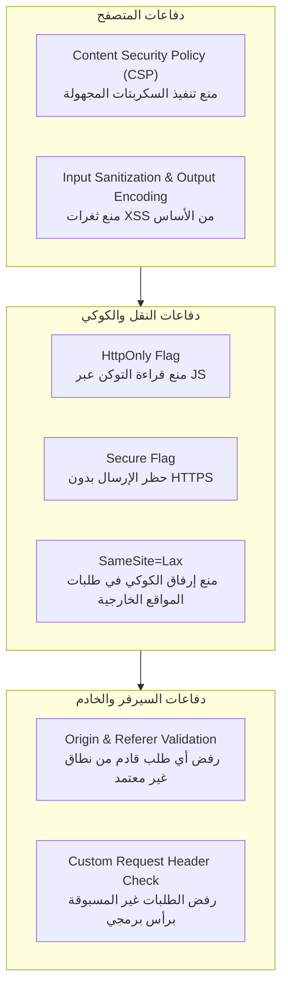
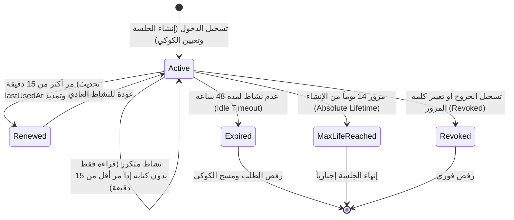
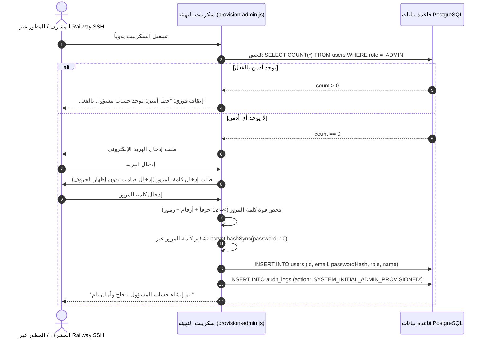
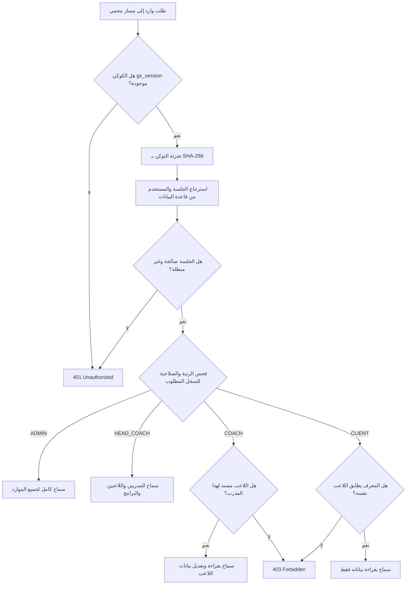

# GX Academy – Milestone 1.3: Centralized Authentication Backend Architecture Design (v2.0)

**Document Version:** 2.0 (Hardened & Revised)  
**Design Date:** 2026-11-02  
**Lead Architect:** Senior Software & Security Architect  
**Scope:** Server-Side Authentication & Session Management with PostgreSQL and Prisma  
**Status:** Architecture Specification (READ-ONLY / NO CODE MODIFICATIONS YET)  
**File:** `docs/architecture/MILESTONE_1_3_AUTHENTICATION_DESIGN.md`  

---

## 1. الملخص التنفيذي والأهداف المصححة (Executive Summary)

تحدد هذه النسخة المحدثة (v2.0) التصميم الهندسي الدقيق لنظام المصادقة المركزي في **GX Academy** استناداً إلى ملاحظات المراجعة الأمنية والمعمارية:
1. **تصحيح فرضيات الحماية:** الكوكي من نوع `HttpOnly` تمنع قراءة نص التوكن عبر JavaScript، لكنها **لا تحمي وحدها من تنفيذ طلبات خبيثة أثناء وجود جلسة نشطة (XSS Session Riding)**؛ ولذلك تم دمج حزمة دفاع متكاملة تشمل Content Security Policy (CSP)، والتحقق الإلزامي من مصدر الطلب (Origin & Referer Validation)، وحماية CSRF.
2. **كبح التخمين المستدام (Persistent & Resilient Rate Limiting):** عدم الاعتماد على ذاكرة Node.js المتطايرة، وتصميم آلية تخزين مستدامة بالاعتماد على PostgreSQL، مع سياسة تعتمد على الـ IP والبريد تمنع هجمات حجب الحساب (Account Lockout DoS).
3. **دورة حياة متوازنة للجلسات (Throttled Session Lifecycle):** وضع حد أقصى مطلق للجلسة (Absolute Lifetime)، وحد لعدم النشاط (Idle Timeout)، مع **تقييد تحديث `lastUsedAt` في قاعدة البيانات (Throttle)** بحيث لا يتم تحديثه إلا إذا مر أكثر من **15 دقيقة**، لمنع إغراق قاعدة البيانات بعمليات كتابة غير ضرورية مع كل Request.
4. **تهيئة مستقلة ومقصودة لأول أدمن (Deliberate First Admin Provisioning):** عزل تام لعملية إنشاء أول أدمن؛ بحيث لا تعمل عند الـ Startup أو الـ Deployment، ولا تعتمد على متغيرات بيئية دائمة أو كلمات مرور مسجلة، بل تُنفذ يدوياً وبشكل مقصود عبر جلسة `railway ssh` تفاعلية ومحمية.
5. **الحدود المعمارية الدقيقة للبيانات (Data Architecture Boundary):** التأكيد القاطع على أن Milestone 1.3 ينقل **المصادقة فقط (Authentication)** إلى PostgreSQL، بينما تظل بيانات الأكاديمية (التمارين، البرامج، الجداول) في طبقة الواجهة مؤقتاً تمهيداً لربطها في المراحل التالية (Milestones 2–4).

---

## 2. مراجعة وتصحيح الحماية: Cookie & XSS & CSRF Defense-in-Depth

### 2.1 تصحيح المفاهيم: سرقة التوكن مقابل ركوب الجلسة (Exfiltration vs Session Riding)
* **ما تمنعه `HttpOnly` فعلياً:** تمنع أي كود خبيث محقون عبر XSS من الوصول إلى قيمة التوكن النصية عبر `document.cookie` أو إرسالها لسيرفر خارجي (Token Exfiltration).
* **ما لا تمنعه `HttpOnly` بمفردها:** إذا نجح المهاجم في حقن كود XSS داخل المتصفح، يمكن لهذا الكود تنفيذ استدعاءات `fetch('/api/admin/delete-user')` مستغلاً أن المتصفح سيرفق كوكي الـ `HttpOnly` تلقائياً مع الطلب طالما الجلسة نشطة (Session Riding).
* **الحزمة الدفاعية المتكاملة المعتمدة:**



### 2.2 سياسة التحقق من مصدر الطلب (Strict Origin & Referer Validation)
في جميع المسارات التي تُحدث تغييراً في البيانات (`POST`, `PUT`, `DELETE`, `PATCH`):
- يتحقق السيرفر من وجود رأس `Origin` أو `Referer`.
- يجب أن يطابق النطاق المعتمد حصرياً:
  - محلياً: `http://localhost:3000`
  - في الإنتاج: `https://gazzar-production.up.railway.app` (أو النطاق المخصص المعتمد).
- أي طلب يفتقر إلى رأس المصدر أو يحمل مصدراً خارجياً يتم رفضه فوراً بكود `403 Forbidden`.

### 2.3 توصيات Content Security Policy (CSP)
تطبيق ترويسات أمنية صارمة عبر Next.js `headers()`:
```text
Content-Security-Policy: default-src 'self'; script-src 'self' 'unsafe-inline' 'unsafe-eval'; style-src 'self' 'unsafe-inline'; img-src 'self' data: https://images.unsplash.com; connect-src 'self'; font-src 'self'; frame-ancestors 'none';
```

---

## 3. هندسة كبح التخمين المستدامة (PostgreSQL-Backed Rate Limiting)

### 3.1 تجنب الذاكرة المتطايرة (Why In-Memory Fails in Production)
الاعتماد على متغيرات في ذاكرة Node.js يفشل في بيئات السحاب (Railway) لسببين:
1. عند إعادة تشغيل الحاوية أو تعافيها من خطأ، تُمسح الذاكرة ويبدأ المهاجم من جديد.
2. في حال تشغيل أكثر من نسخة متزامنة (Horizontal Scaling)، لا تشترك النسخ في الذاكرة.

### 3.2 التصميم المعتمد: جدول محاولات الدخول في PostgreSQL
تصميم جدول خفيف وسريع في قاعدة البيانات لتتبع المحاولات الفاشلة:
```prisma
model LoginAttempt {
  id        String   @id @default(uuid())
  ipAddress String
  email     String?
  createdAt DateTime @default(now())

  @@index([ipAddress, createdAt])
  @@index([email, createdAt])
  @@map("login_attempts")
}
```

### 3.3 سياسة الـ IP والبريد ومنع حجب الحسابات التعسفي (Preventing Account Lockout DoS)
* **المشكلة الشائعة:** إذا تم قفل حساب مستخدم بمجرد ورود 5 محاولات فاشلة على بريده، يستطيع أي مهاجم كتابة بريد الأدمن 5 مرات لإيقاف حسابه ومنعه من دخول النظام نهائياً (Denial of Service).
* **الحل المعتمد في GX Academy:**
  1. **الكبح الأساسي على عنوان الـ IP:**
     - إذا تجاوز الـ IP الواحد **5 محاولات فاشلة** خلال **15 دقيقة**، يُحظر هذا الـ IP بالكامل لمدة 15 دقيقة (كود `429 Too Many Requests`).
     - لا يتأثر حساب الأدمن إذا حاول الدخول من IP آخر موثوق.
  2. **الكبح التراكمي على مستوى البريد (Progressive Delay):**
     - عند تكرار الفشل لنفس البريد من عناوين IP متعددة (هجوم موزع Distributed Brute-Force)، لا نقفل الحساب بل نطبق تأخيراً تصاعدياً (Exponential Sleep) في استجابة السيرفر (1s -> 2s -> 4s) مع طلب رمز تحقق إضافي في المراحل المتقدمة.
  3. **تنظيف السجلات التلقائي (Log Retention TTL):**
     - حذف سجلات المحاولات التي مضى عليها أكثر من 24 ساعة دورياً لضمان بقاء الجدول صغيراً وسريع الفهرسة.

---

## 4. دورة حياة الجلسات وضبط استهلاك قاعدة البيانات (Session Lifecycle)

لمنع إجهاد قاعدة بيانات السيرفر بعمليات كتابة متكررة مع كل نقرة في الموقع:



### 4.1 المحددات الزمنية الصارمة للجلسة:
1. **الحد الأقصى المطلق (Absolute Lifetime):** **14 يوماً**. تنتهي الجلسة تماماً وتطلب إعادة تسجيل الدخول مهما كان المستخدم نشطاً.
2. **مهلة عدم النشاط (Idle Timeout):** **48 ساعة**. إذا لم يفتح المستخدم التطبيق لمدة يومين متتاليين، تنتهي الجلسة تلقائياً.
3. **تقييد تحديث الاستخدام (Throttled `lastUsedAt` Update):**
   - عند كل طلب HTTP، يقرأ السيرفر الجلسة من الـ Cache أو القاعدة للتأكد من أنها غير مبطلة (`revokedAt IS NULL`).
   - **لا يتم تعديل حقل `lastUsedAt` إلا إذا مر أكثر من 15 دقيقة** على آخر تحديث:
     ```ts
     const FIFTEEN_MINUTES = 15 * 60 * 1000;
     if (Date.now() - session.lastUsedAt.getTime() > FIFTEEN_MINUTES) {
       // تحديث غير متزامن في الخلفية دون تعطيل استجابة الطلب
       prisma.session.update({
         where: { id: session.id },
         data: { lastUsedAt: new Date() }
       }).catch(console.error);
     }
     ```
4. **تسجيل الخروج من كافة الأجهزة (Logout All Other Devices):**
   إتاحة خيار في الإعدادات يبطل كل جلسات المستخدم السابقة عبر استعلام واحد:
   ```ts
   await prisma.session.updateMany({
     where: { userId: currentUserId, revokedAt: null, id: { not: currentSessionId } },
     data: { revokedAt: new Date() }
   });
   ```
5. **الإبطال الإجباري عند تغيير كلمة المرور:**
   تغيير كلمة المرور يبطل فوراً **جميع** الجلسات النشطة للمستخدم في جدول `sessions` لضمان خروج أي مخترق محتمل فوراً.

---

## 5. آلية تهيئة أول أدمن المستقلة والمحمية (First Admin Provisioning)

### 5.1 مبادئ التصميم الصارمة:
1. **لا تشغيل تلقائي (No Startup Provisioning):** السكريبت لا يعمل ضمن أمر البدء السحابي `railway:start`، ولا يعمل عند الـ Deployment.
2. **لا بيانات في السورس كود أو Git:** لن يتم تخزين البريد أو كلمة المرور داخل أي ملف في المستودع.
3. **لا متغيرات بيئية دائمة في السيرفر:** تفادي وضع `ADMIN_PASSWORD` كمتغير بيئي دائم في Railway Dashboard؛ حتى لا يظهر لأي مطور يطلع على لوحة التحكم.

### 5.2 طريقة التنفيذ اليدوية المعتمدة من داخل Railway Runtime:
تتم التهيئة حصرياً وبشكل مقصود لمرة واحدة من خلال اتصال المطور بالسيرفر عبر **Railway SSH**:
```bash
# تشغيل أمر التهيئة التفاعلي داخل الحاوية السحابية
railway ssh "node scripts/provision-admin.js"
```



---

## 6. مصفوفة الصلاحيات الدقيقة على السيرفر (Fine-Grained Authorization Matrix)

تعتمد الصلاحيات حصرياً على **فحص السيرفر المباشر من قاعدة البيانات**، ولا يُعتد بأي بيانات مرسلة من العميل:



| المورد (Resource) | العمليات (Operations) | الأدمن (`ADMIN`) | المدرب الرئيسي (`HEAD_COACH`) | المدرب (`COACH`) | اللاعب (`CLIENT`) |
| :--- | :--- | :---: | :---: | :---: | :---: |
| **المستخدمون (`/api/users`)** | قراءة / إضافة / حذف | ✅ كامل الصلاحية | ❌ ممنوع | ❌ ممنوع | ❌ ممنوع |
| **بيانات اللاعبين (`/api/clients`)** | استعراض القائمة | ✅ جميع اللاعبين | ✅ جميع اللاعبين | 🔒 اللاعبين المسندين له فقط | ❌ ممنوع |
| **ملف لاعب محدد (`/api/clients/[id]`)** | قراءة وتعديل | ✅ كامل الصلاحية | ✅ كامل الصلاحية | 🔒 إذا كان مسنداً له فقط | 🔒 ملفه الشخصي فقط (قراءة) |
| **التمارين والبرامج (`/api/exercises`)**| إنشاء وتعديل | ✅ كامل الصلاحية | ✅ كامل الصلاحية | 🔒 تمارينه وبرامجه فقط | ❌ قراءة التمارين المسندة له |
| **سجلات التدقيق (`/api/audit-logs`)** | استعراض السجلات | ✅ كامل الصلاحية | ❌ ممنوع | ❌ ممنوع | ❌ ممنوع |

---

## 7. الحدود المعمارية للبيانات (Data Architecture Boundary)

نؤكد في هذا التصميم على مبدأ **الفصل المرحلي الصارم**:
* **نطاق Milestone 1.3:** نقل **المصادقة وإدارة الجلسات فقط** إلى خادم PostgreSQL:
  - جدول `users` (لحسابات الدخول وكلمات المرور المشفرة).
  - جدول `sessions` (لتخزين وإبطال الجلسات المركزية).
  - جدول `login_attempts` (لكبح التخمين).
* **بيانات الأكاديمية التشغيلية (اللاعبين، التمارين، الاشتراكات):**
  - تظل في طبقة `localStorage` مؤقتاً لتشغيل واجهات النظام الحالية دون انقطاع.
  - سيتم ربط هذه البيانات تدريجياً بـ PostgreSQL في المعالم التالية:
    - **Milestone 2:** نقل المستخدمين والمدربين واللاعبين (`CoachProfile`, `ClientProfile`).
    - **Milestone 3:** نقل الألعاب والتمارين والبرامج التدريبية (`Sports`, `Exercises`, `Programs`).
    - **Milestone 4:** نقل الاشتراكات وسجلات التدريب والحضور (`Memberships`, `WorkoutLogs`, `Attendance`).

---

## 8. الخلاصة

يقدم هذا التصميم المحدث (v2.0) إجابة هندسية حاسمة ودقيقة على كافة الملاحظات:
- صلحنا مفاهيم حماية الـ Cookies ودعمناها بـ Origin Validation و CSP.
- بنينا Rate Limiting مستداماً على مستوى PostgreSQL بدون قفل حسابات تعسفي.
- قيدنا استهلاك قاعدة البيانات في تحديث الجلسات ليكون دورياً وليس مع كل Request.
- عزلنا عملية أول أدمن لتكون يدوية، صامتة، ومقصودة عبر Railway SSH.
- حددنا بوضوح مصفوفة الصلاحيات والحدود المعمارية الفاصلة بين المصادقة وبيانات الأكاديمية.
