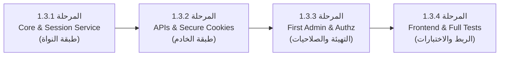

# GX Academy – Milestone 1.3: Implementation Plan

**Document Version:** 1.0  
**Planning Date:** 2026-11-02  
**Lead Architect:** Senior Software & Security Architect  
**Stage:** Milestone 1.3 – Centralized Authentication Backend Implementation Roadmap  
**Target Architecture:** Next.js 14 App Router + Prisma ORM + PostgreSQL  
**File:** `docs/architecture/MILESTONE_1_3_IMPLEMENTATION_PLAN.md`  

---

## 1. الهيكل التنفيذي المرحلي (Phased Implementation Strategy)

لضمان أقصى درجات الاستقرار وعدم كسر أي ميزة في النظام الحالي، تم تقسيم تنفيذ **Milestone 1.3** إلى **4 مراحل متسلسلة ومستقلة**:

---

## 2. تفصيل المراحل التنفيذية الأربعة

### المرحلة 1.3.1: خدمات الجلسات ونواة المصادقة (Session Service & Auth Core)

#### الهدف:
بناء طبقة الخدمات المركزية المسؤولة عن معالجة التشفير، والتعامل المباشر مع جداول `users` و `sessions` و `login_attempts` في Prisma.

#### المخرجات البرمجية:
1. **[`src/lib/auth/password.ts`](file:///d:/Gazzar%20Project/src/lib/auth/password.ts):**
   - دوال التشفير والتحقق الصارم باستخدام `bcryptjs` (Cost 10).
   - التحقق من قوة كلمة المرور (طول لا يقل عن 12 حرفاً، أرقام، رموز).
2. **[`src/lib/auth/session.ts`](file:///d:/Gazzar%20Project/src/lib/auth/session.ts):**
   - توليد رموز الجلسات العشوائية الآمنة (CSPRNG 256-bit عبر `crypto.randomBytes(32)`).
   - تجزئة التوكن بـ SHA-256 قبل الحفظ في قاعدة البيانات.
   - إنشاء سجل الجلسة في جدول `sessions` مع المحددات الزمنية (14 يوماً كحد أقصى، 48 ساعة عدم نشاط).
   - دالة `validateSession(token)`: التحقق من سريان الجلسة وعدم إبطالها (`revokedAt IS NULL`).
   - دالة تقييد تحديث `lastUsedAt` (فقط إذا مر أكثر من 15 دقيقة على آخر استخدام).
   - دالة `revokeSession(token)`: إبطال الجلسة الحالية.
   - دالة `revokeAllUserSessions(userId)`: إبطال كافة جلسات المستخدم السابقة.
3. **[`src/lib/auth/rate-limit.ts`](file:///d:/Gazzar%20Project/src/lib/auth/rate-limit.ts):**
   - التحقق من عدد المحاولات الفاشلة لعنوان الـ IP (حد أقصى 5 محاولات لكل 15 دقيقة).
   - تطبيق التأخير التصاعدي للبريد دون قفل الحساب.
   - تنظيف السجلات القديمة دورياً.

#### معيار النجاح والاختبار:
- كتابة اختبارات Unit تختبر دوال التشفير، وتجزئة التوكنات، واحتساب الفارق الزمني لتحديث `lastUsedAt` بنجاح 100%.

---

### المرحلة 1.3.2: واجهات البرمجة والكوكيز الآمنة (APIs & Secure Cookie Management)

#### الهدف:
بناء الـ Endpoints في Next.js وتعيين الكوكيز الآمنة لحماية جلسات المتصفح وتطبيق الدفاع بالعمق.

#### المخرجات البرمجية:
1. **[`src/lib/auth/cookies.ts`](file:///d:/Gazzar%20Project/src/lib/auth/cookies.ts):**
   - دالة `setSessionCookie(token)`: تعيين كوكي `gx_session` بخصائص `HttpOnly; Secure; SameSite=Lax; Path=/; Max-Age=604800`.
   - دالة `getSessionCookie()`: قراءة الكوكي بأمان من الطلب.
   - دالة `clearSessionCookie()`: مسح الكوكي فورياً عند تسجيل الخروج.
2. **[`src/app/api/auth/login/route.ts`](file:///d:/Gazzar%20Project/src/app/api/auth/login/route.ts):**
   - فحص الـ Origin والرؤوس المعتمدة.
   - فحص الـ Rate Limit لعنوان الـ IP.
   - الاستعلام من `prisma.user.findUnique({ where: { email } })`.
   - فحص كلمة المرور بـ `bcrypt.compare`.
   - إنشاء الجلسة في جدول `sessions` وتعيين الكوكي.
   - إرجاع كائن المستخدم مجرداً من أي أسرار.
3. **[`src/app/api/auth/me/route.ts`](file:///d:/Gazzar%20Project/src/app/api/auth/me/route.ts):**
   - قراءة كوكي الجلسة والتحقق منها عبر `validateSession`.
   - استرجاع بيانات المستخدم من قاعدة البيانات وإرجاعها للواجهة.
4. **[`src/app/api/auth/logout/route.ts`](file:///d:/Gazzar%20Project/src/app/api/auth/logout/route.ts):**
   - إبطال الجلسة الحالية في جدول `sessions` ومسح الكوكي.

#### معيار النجاح والاختبار:
- اختبار استدعاءات الـ API محلياً والتأكد من إرسال رؤوس `Set-Cookie` الصحيحة ورفض الطلبات ذات المصدر غير الموثوق (Origin Validation).

---

### المرحلة 1.3.3: تهيئة أول أدمن وتطبيق الصلاحيات (First Admin Provisioning & Server Authorization)

#### الهدف:
إنشاء أداة التهيئة الآمنة لحساب الأدمن، وتطبيق صلاحيات الخادم لمنع الوصول غير المصرح به وثغرات IDOR.

#### المخرجات البرمجية:
1. **[`scripts/provision-admin.js`](file:///d:/Gazzar%20Project/scripts/provision-admin.js):**
   - سكريبت تفاعلي ومحمي يعمل عبر `node scripts/provision-admin.js`.
   - فحص إلزامي: إلغاء التشغيل فوراً إذا وجد أي مستخدم برتبة `ADMIN` في PostgreSQL.
   - قراءة البريد وكلمة المرور بصمت دون إظهارها على الشاشة.
   - التحقق من قوة كلمة المرور، وتشفيرها بـ `bcrypt`، وإدراج السجل في جدول `users`.
   - توثيق العملية في جدول `audit_logs`.
2. **[`src/lib/auth/guards.ts`](file:///d:/Gazzar%20Project/src/lib/auth/guards.ts):**
   - دالة `requireAuth(request)`: استخراج والتحقق من الجلسة وإرجاع المستخدم.
   - دالة `requireRole(request, allowedRoles)`: فحص صلاحيات الرتبة على السيرفر.
   - دالة `assertCoachClientAccess(coachId, clientId)`: التحقق من إسناد اللاعب للمدرب لمنع ثغرات IDOR.
3. **تطبيق الـ Guards على مسارات الـ API القائمة:**
   - حماية `/api/users` و `/api/clients` و `/api/exercises` و `/api/workouts`.

#### معيار النجاح والاختبار:
- اختبار تشغيل سكريبت أول أدمن والتحقق من إلغائه عند تكرار المحاولة، واختبار حظر لاعب أو مدرب من مسارات غير مصرحة بكود `403 Forbidden`.

---

### المرحلة 1.3.4: ربط الواجهة واختبارات النظام الكاملة (Frontend Integration & Verification)

#### الهدف:
تحويل سياق المصادقة في الواجهة ليعتمد على السيرفر المركزي، وتأكيد تجربة المستخدم واستقرار النظام.

#### المخرجات البرمجية:
1. **[`src/context/AuthContext.tsx`](file:///d:/Gazzar%20Project/src/context/AuthContext.tsx):**
   - تعديل `useEffect` عند الإقلاع ليستدعي `GET /api/auth/me`.
   - تعديل دالة `login` لتستدعي `POST /api/auth/login`.
   - تعديل دالة `logout` لتستدعي `POST /api/auth/logout`.
   - إلغاء قراءة وكتابة الجلسات من `localStorage`.
2. **[`src/components/layout/AppShell.tsx`](file:///d:/Gazzar%20Project/src/components/layout/AppShell.tsx):**
   - الحفاظ على تجربة التنقل والانتقال السلس لـ `/login` عند عدم وجود جلسة.
3. **حزمة اختبارات التكامل الشاملة ([`tests/auth-integration.test.mjs`](file:///d:/Gazzar%20Project/tests/auth-integration.test.mjs)):**
   - اختبار دورة تسجيل الدخول والخروج الكاملة.
   - اختبار محاولات الدخول الخاطئة والكبح.
   - اختبار الجلسات المنتهية والمبطلة.
   - اختبار محاولات الوصول غير المصرح به.

---

## 3. مصفوفة إدارة المخاطر وحدود التنفيذ (Risk Controls & Boundaries)

| الخطر المحتمل | الإجراء الوقائي في خطة التنفيذ |
| :--- | :--- |
| **تعطل شاشات النظام الحالية** | واجهات التمارين والبرامج والجداول ستستمر في قراءة بياناتها من الـ Mock Layer مؤقتاً، ولن يتغير عليها سوى مصدر هوية المستخدم المسجل (`user`). |
| **انقطاع الدخول بعد النشر** | لن يتم عمل Deploy للـ Production إلا بعد: (1) تطبيق الـ Schema، (2) تشغيل سكريبت أول أدمن بنجاح عبر `railway ssh`، (3) التحقق من تسجيل دخول الأدمن. |
| **تسريب بيانات الاعتماد** | سكريبت التهيئة لا يطبع أي أسرار، ولا توجد أي كلمة مرور في ملفات المشروع أو الـ Git. |
| **إجهاد السيرفر بتحديثات الجلسات** | تقييد تحديث `lastUsedAt` ليعمل كل 15 دقيقة فقط في الخلفية. |

---

## 4. شروط الانتقال بين المراحل (Gate Criteria)

1. **Gate 1 (نهاية 1.3.1):** اجتياز اختبارات الـ Core والـ Session Service بنسبة 100%.
2. **Gate 2 (نهاية 1.3.2):** نجاح استدعاءات الـ APIs وتوليد وتدقيق الكوكيز محلياً.
3. **Gate 3 (نهاية 1.3.3):** نجاح تجربة سكريبت أول أدمن في بيئة اختبار معزولة وتأكيد حماية الصلاحيات.
4. **Gate 4 (نهاية 1.3.4):** نجاح الـ Build الكامل (`npm run build`) واجتياز حزمة الاختبارات الشاملة (11/11 سيناريو).

> **تذكير بالالتزام الأمني:**  
> نحن الآن في مرحلة اعتماد خطة التنفيذ فقط؛ ولن يتم لمس أي كود أو قاعدة بيانات حتى نتلقى موافقتك الصريحة على بدء **المرحلة 1.3.1**.
