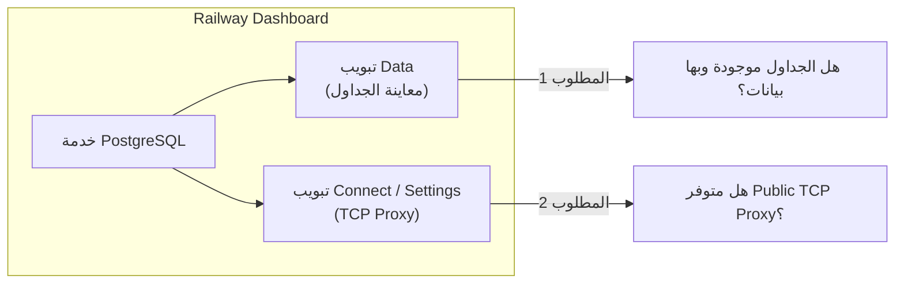
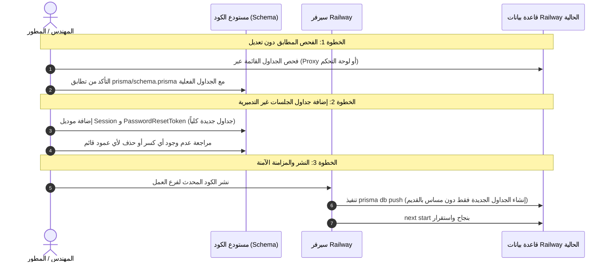

# GX Academy – خطة العمل والتعامل الآمن مع بيئة العمل الحالية (Railway)

**تاريخ التوثيق:** 2026-11-02  
**المسؤول:** مهندس البنية التحتية وقواعد البيانات (DevOps & Database Architect)  
**الحالة:** معتمدة وفقاً للقرار النهائي (Working on Existing Active Environment)  
**الملف:** `docs/database/EXISTING_ENVIRONMENT_ACTION_PLAN.md`  

---

## 1. تصحيح المسار والقرار النهائي المعتمد

بناءً على التوجيه الصادر:
1. **لا بيئات جديدة:** تم إلغاء أي توجه لإنشاء Test Environment أو Staging أو بيئة إضافية على Railway.
2. **لا قواعد بيانات جديدة:** لن يتم إنشاء PostgreSQL Database جديدة سواء على السحاب أو Docker أو محلياً.
3. **البيئة الحالية هي بيئة العمل (Active Working Environment):** العمل مستمر مباشرة على البيئة الموجودة وقاعدة البيانات المرتبطة بها على Railway.
4. **حظر كامل لأي أوامر تدميرية:** يُمنع منعاً باتاً استخدام `prisma migrate reset` أو أي أمر يؤدي لحذف بيانات أو مسح الجداول.
5. **التأني ومراجعة آليات النشر:** لن يتم تغيير أمر `prisma db push` أو أسلوب النشر بشكل عشوائي قبل الفحص الدقيق والاتفاق على الخطة.

---

## 2. الوضع الفعلي لبيئة Railway الحالية وقاعدة البيانات

### 2.1 توصيف البيئة الحالية (Active Environment)
- **مزود الاستضافة:** Railway.app.
- **نوع المشروع:** مشروع أحادي (Single Project) يضم خدمة التطبيق (Next.js) وخدمة قاعدة البيانات (PostgreSQL).
- **البيئة المستهدفة:** بيئة العمل النشطة (Working Environment) المربوطة بمستودع GitHub (`itqansolutions/Gazzar`).

### 2.2 بيانات الاتصال بقاعدة البيانات (مُشفّرة بالكامل)
- **المضيف (Host):** `postgres.railway.internal` (عنوان خاص داخل شبكة Railway الافتراضية VPC).
- **المنفذ (Port):** `5432`.
- **اسم قاعدة البيانات (Database):** `railway`.
- **المستخدم (User):** `postgres`.
- **كلمة المرور:** مشفرة ومحمية بالكامل داخل متغيرات البيئة.
- **طبيعة الاتصال الحالي:**
  الاتصال المباشر عبر `postgres.railway.internal` متاح **حصرياً** للتطبيقات التي تعمل داخل سيرفرات Railway نفسها. ولا يمكن لجهاز التطوير الخارجي (Local PC) الوصول لهذا العنوان بدون تفعيل منفذ خارجي عام (Public TCP Proxy).

---

## 3. مراجعة إعدادات التشغيل: `railway.json` و `nixpacks.toml` و `package.json`

قمنا بفحص سلسلة الأوامر المسؤولة عن بناء وتشغيل التطبيق على Railway:

### 3.1 ملف [`railway.json`](file:///d:/Gazzar%20Project/railway.json)
```json
{
  "$schema": "https://railway.app/railway.schema.json",
  "build": {
    "builder": "NIXPACKS"
  },
  "deploy": {
    "startCommand": "npm run railway:start",
    "restartPolicyType": "ON_FAILURE",
    "restartPolicyMaxRetries": 10
  }
}
```
- Railway يعتمد على **Nixpacks** كمحرك للبناء (Builder).
- أمر التشغيل المعتمد هو: `npm run railway:start`.
- سياسة إعادة التشغيل عند الفشل: محاولة الإعادة حتى 10 مرات.

### 3.2 ملف [`nixpacks.toml`](file:///d:/Gazzar%20Project/nixpacks.toml)
- مرحلة الإعداد (`setup`): تثبيت `nodejs_20` و `openssl`.
- مرحلة التثبيت (`install`): تنفيذ `npm ci` للحزم.
- مرحلة البناء (`build`): تنفيذ `npx prisma generate` ثم `npm run build`.
- مرحلة البدء (`start`): تنفيذ `npm run railway:start`.

### 3.3 أمر `railway:start` في [`package.json`](file:///d:/Gazzar%20Project/package.json)
```json
"railway:start": "prisma generate && prisma db push && node prisma/seed.js && next start"
```

---

## 4. الفحص المعماري لأمر `prisma db push` ومخاطره

### 4.1 لماذا تم وضع `prisma db push` في أمر التشغيل أساساً؟
في مراحل بناء النماذج الأولية (Prototypes)، يلجأ المطورون لوضع `prisma db push` في أمر التشغيل بحيث تتم مزامنة التعديلات في ملف `prisma/schema.prisma` تلقائياً مع قاعدة البيانات عند كل عملية نشر (Deployment) دون الحاجة لفتح Terminal يدوي أو إنشاء ملفات Migrations يدوية.

### 4.2 هل التطبيق حالياً يعتمد على `prisma db push` للعمل؟
- **فحص كود التطبيق:** وجدنا أن صفحات الـ Frontend والـ API Routes الحالية **لا تستدعي عميل Prisma على الإطلاق** (تعتمد حتى الآن على البيانات التجريبية `src/lib/db.ts`).
- ملف `prisma/seed.js` هو مجرد سطر واحد يطبع جملة نصية ولا يكتب أي بيانات.
- بالتالي: التطبيق الحالي لا يتأثر تشغيلياً ببيانات الـ Database، ولكن وجود `prisma db push` في أمر البدء يعني أن سيرفر Railway **يقوم بفحص ومزامنة قاعدة البيانات فعلياً عند كل Deployment**.

### 4.3 المخاطر الحقيقية لتنفيذ `prisma db push` تلقائياً عند كل نشر:
1. **في التعديلات الآمنة (إضافة جداول أو أعمدة اختيارية جديدة):**
   - يعمل بسلاسة دون مساس بالبيانات الموجودة (مثلاً: إضافة جدول `Session` جديد لن يؤثر على الجداول القديمة).
2. **في التعديلات التي قد تتضمن حذف أو إعادة تسمية (Breaking Changes):**
   - إذا تم حذف حقل، أو إعادة تسمية عمود، أو تغيير نوع عمود يحتوي على بيانات، فإن Prisma تكتشف وجود احتمالية لفقدان بيانات (Data Loss).
   - وحيث أن الأمر يعمل بدون معامل `--accept-data-loss` وفي بيئة آلية بدون واجهة تفاعلية، فإن `prisma db push` **ستفشل فوراً وتخرج بكود خطأ (Exit Code 1)**.
   - **النتيجة الكارثية:** سيتوقف أمر البدء `railway:start` ولن يصل إلى `next start`، وسيدخل التطبيق في حلقة انهيار وإعادة تشغيل متكررة (Crash Loop حتى 10 محاولات) ويتوقف الموقع عن العمل تماماً!
3. **غياب سجل التعديلات (No Migration History):**
   - الـ `db push` لا يُنشئ مجلد `prisma/migrations/`، مما يجعل من المستحيل تتبع التغييرات أو التراجع عنها (Rollback) بطريقة منظمة.

---

## 5. المعلومات المطلوبة من لوحة تحكم Railway (Dashboard)

حيث أن جهاز التطوير الحالي لا يمكنه الوصول لشبكة Railway الداخلية `postgres.railway.internal`، نحتاج تأكيد 3 معلومات بسيطة من لوحة تحكم Railway للبدء الآمن:



### 1. حالة الجداول والبيانات الحالية (تبويب Data):
- عند الدخول على خدمة **PostgreSQL** في Railway ثم الضغط على تبويب **Data**:
  - هل تظهر جداول المشروع الأساسية (مثل `User`, `Sport`, `Exercise`, `ClientProfile`, ... إلخ)؟
  - هل توجد صفوف بيانات مسجلة ومهمة حالياً داخل هذه الجداول؟

### 2. إتاحة الاتصال الخارجي المباشر (Public TCP Proxy):
- في نفس خدمة **PostgreSQL**، تحت تبويب **Settings** أو **Connect**:
  - ابحث عن **Public Networking** أو **TCP Proxy**.
  - إذا كان مفعلاً، يوفر Railway رابط اتصال عام يبدأ بـ:
    `postgresql://postgres:[PASSWORD]@[HOST].proxy.rlwy.net:[PORT]/railway`
  - *فائدة هذا الرابط:* يسمح لنا بفحص هيكل قاعدة البيانات الحالي (قراءة فقط بدون كتابة) عبر أدوات Prisma من بيئة التطوير المحلية دون التأثير على عمل التطبيق على Railway.

### 3. سجلات آخر عملية نشر (Deployment Logs):
- في خدمة التطبيق (Next.js Web Service) -> آخر نشر (Latest Deployment) -> انظر في الـ Build/Deploy Logs:
  - هل ظهرت رسالة: `"The database is already in sync with the Prisma schema."`؟

---

## 6. الخطة التنفيذية الآمنة خطوة بخطوة (Safe Execution Plan)

سنتبع المنهجية الهندسية التالية لضمان سلامة البيانات بنسبة 100%:



### تفاصيل المراحل:

#### المرحلة 1: مطابقة الـ Schema القائمة (Read-Only Baseline)
- التأكد من أن ملف [`prisma/schema.prisma`](file:///d:/Gazzar%20Project/prisma/schema.prisma) الحالي مطابق للجداول المنشأة في قاعدة بيانات Railway، لضمان عدم وجود أي تعارض سابق.

#### المرحلة 2: إضافة جداول الأمان الجديدة فقط (Additive Only)
- في Milestone 1.2، سنضيف فقط الجداول المستقلة الخاصة بالمصادقة:
  - جدول `Session` (لإدارة جلسات الدخول المشفرة).
  - جدول `PasswordResetToken` (لإدارة استعادة كلمات المرور).
- **ضمانة هندسية:** هذه الجداول جديدة بالكامل ولا تُعدل ولا تحذف أي جدول أو عمود قائم في قاعدة البيانات، مما يجعل مزامنتها عبر `prisma db push` خالية تماماً من مخاطر فقدان البيانات.

#### المرحلة 3: التوثيق والتجهيز للربط الفعلي
- بعد استقرار الهيكل على بيئة العمل، نبدأ في تفعيل الـ API Routes لتقرأ وتكتب في قاعدة البيانات بدلاً من `localStorage`.

---

## 7. الخلاصة والقرار المقترح للخطوة القادمة

1. **البيئة الحالية مؤكدة ومعتمدة كبيئة عمل وحيدة.**
2. **أمر `prisma db push` سيبقى كما هو حالياً** احتراماً لآلية النشر الحالية وتفادياً لتعطيل خط إنتاج Railway.
3. **التعديلات القادمة ستكون Additive فقط (إضافية لا تدميرية).**

**الخطوة المطلوبة الآن من سيادتك:**
مراجعة ما إذا كان تبويب **Data** في Railway يحتوي على جداول وبيانات مسجلة، وتأكيد ما إذا كان متاحاً لديك رابط **TCP Proxy** لقاعدة البيانات، لنبدأ فوراً في صياغة موديلات الجلسات (Milestone 1.2) بكل أمان واطمئنان.
