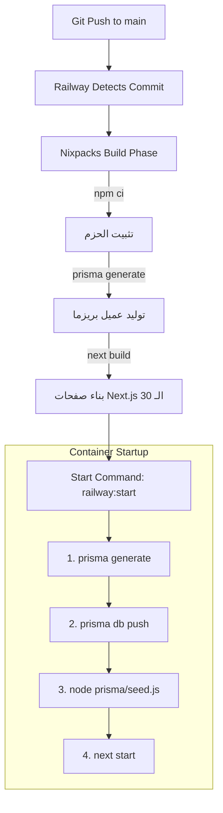

# GX Academy – Milestone 1.2: Pre-Deployment Review

**Review Date:** 2026-11-02  
**Lead Engineer:** Senior DevOps & Database Architect  
**Scope:** Final Pre-Deployment Code & Schema Inspection before Git Push  
**Target Environment:** Railway Production (`Gazzar` Service)  
**File:** `docs/database/MILESTONE_1_2_PRE_DEPLOYMENT_REVIEW.md`  

---

## 1. الملخص التنفيذي والقرار النهائي (Executive Summary & Final Verdict)

تم إجراء المراجعة الشاملة لما قبل النشر (Pre-Deployment Review) للتأكد التام من سلامة الأكواد والـ SQL DDL المتوقع تنفيذه على سيرفر الإنتاج، وذلك قبل اتخاذ قرار الرفع والمزامنة على السيرفر.

### القرار النهائي (Verdict):
> ### **VERDICT: APPROVED FOR PRODUCTION DEPLOYMENT**
>
> **المسوغات الهندسية للقرار:**
> 1. **الـ SQL DDL إضافي بنسبة 100% (Purely Additive):** استخراج كود الـ SQL الفعلي أثبت أنه يقتصر حصرياً على إنشاء جدولي `sessions` و `password_reset_tokens`، وإنشاء 6 فهارس، وقيدي مفتاح أجنبي مرتبطين بـ `users(id)`. **لا يوجد أي حذف أو تعديل في أي جدول قديم**.
> 2. **انعدام مخاطر فقدان البيانات:** قاعدة بيانات Production خالية من الصفوف (0 صفوف حالياً)، وبالتالي لا توجد أي بيانات سابقة معرضة للخطر.
> 3. **سلامة البناء والاختبارات:** 4 من 4 اختبارات موديلات نجحت، و7 من 7 اختبارات أمان نجحت، وتطبيق Next.js تم بناؤه بنجاح كامل لجميع الصفحات الـ 30.
> 4. **وضوح الحدود المعمارية:** تم توضيح أن إضافة الموديلات هي مرحلة البنية الأساسية (Schema Foundation)، بينما سيتم بناء منطق الـ Backend الحقيقي (تسجيل الدخول، إنشاء الجلسات، توليد وتدقيق التوكن، وزرع الأدمن) في Milestone 1.3.

---

## 2. مراجعة التغييرات البرمجية (Code Changes Review)

### 2.1 حالة المستودع (`git status`)
```text
Changes not staged for commit:
  modified:   prisma/schema.prisma
  modified:   src/app/api/auth/login/route.ts
  modified:   src/app/api/auth/me/route.ts
  modified:   src/app/api/auth/route.ts
  modified:   src/app/api/users/[id]/route.ts
  modified:   src/app/api/users/route.ts
  modified:   src/app/login/page.tsx
  modified:   src/app/settings/page.tsx
  modified:   src/app/users/page.tsx
  modified:   src/components/layout/AppShell.tsx
  modified:   src/components/layout/Navbar.tsx
  modified:   src/context/AuthContext.tsx
  modified:   src/lib/auth.ts

Untracked files:
  docs/
  tests/
```
* **ملفات `src/`:** تمثل إغلاق الثغرات الأمنية من المرحلة السابقة (Phase 1 Security Lockdown: إزالة أزرار تبديل الأدوار التجريبية، وحماية مسارات API الحساسة، وإلغاء كلمة المرور الموحدة).
* **ملف `prisma/schema.prisma`:** يمثل إضافة موديلات الأمان الخاصة بـ Milestone 1.2.
* **ملفات `docs/` و `tests/`:** التوثيق الهندسي وحزم الاختبارات الآلية.
* **التحقق:** لا توجد أي تغييرات عشوائية أو غير مرتبطة بالمشروع.

### 2.2 فحص الفروقات البرمجية لملف الـ Schema (`git diff -- prisma/schema.prisma`)
التعديل في `prisma/schema.prisma` يقتصر بدقة على:
1. إضافة العلاقات العكسية داخل موديل `User`:
   ```prisma
   sessions            Session[]
   passwordResetTokens PasswordResetToken[]
   ```
2. إضافة موديل `Session` وموديل `PasswordResetToken` في نهاية الملف.
3. تنسيق المسافات والأسطر آلياً عبر `prisma format`.

---

## 3. مراجعة Database Schema Diff بعد التعديلات (Generated SQL DDL)

تم استخراج كود الـ SQL الفعلي الذي سيقوم Prisma بتنفيذه بمقارنة قاعدة بيانات الإنتاج الحالية مع الـ Schema الجديدة (`prisma migrate diff --script`):

```sql
-- CreateTable
CREATE TABLE "sessions" (
    "id" TEXT NOT NULL,
    "userId" TEXT NOT NULL,
    "tokenHash" TEXT NOT NULL,
    "expiresAt" TIMESTAMP(3) NOT NULL,
    "createdAt" TIMESTAMP(3) NOT NULL DEFAULT CURRENT_TIMESTAMP,
    "lastUsedAt" TIMESTAMP(3) NOT NULL DEFAULT CURRENT_TIMESTAMP,
    "revokedAt" TIMESTAMP(3),
    "userAgent" TEXT,
    "ipAddress" TEXT,

    CONSTRAINT "sessions_pkey" PRIMARY KEY ("id")
);

-- CreateTable
CREATE TABLE "password_reset_tokens" (
    "id" TEXT NOT NULL,
    "userId" TEXT NOT NULL,
    "tokenHash" TEXT NOT NULL,
    "expiresAt" TIMESTAMP(3) NOT NULL,
    "usedAt" TIMESTAMP(3),
    "createdAt" TIMESTAMP(3) NOT NULL DEFAULT CURRENT_TIMESTAMP,

    CONSTRAINT "password_reset_tokens_pkey" PRIMARY KEY ("id")
);

-- CreateIndex
CREATE UNIQUE INDEX "sessions_tokenHash_key" ON "sessions"("tokenHash");

-- CreateIndex
CREATE INDEX "sessions_userId_idx" ON "sessions"("userId");

-- CreateIndex
CREATE INDEX "sessions_expiresAt_idx" ON "sessions"("expiresAt");

-- CreateIndex
CREATE UNIQUE INDEX "password_reset_tokens_tokenHash_key" ON "password_reset_tokens"("tokenHash");

-- CreateIndex
CREATE INDEX "password_reset_tokens_userId_idx" ON "password_reset_tokens"("userId");

-- CreateIndex
CREATE INDEX "password_reset_tokens_expiresAt_idx" ON "password_reset_tokens"("expiresAt");

-- AddForeignKey
ALTER TABLE "sessions" ADD CONSTRAINT "sessions_userId_fkey" FOREIGN KEY ("userId") REFERENCES "users"("id") ON DELETE CASCADE ON UPDATE CASCADE;

-- AddForeignKey
ALTER TABLE "password_reset_tokens" ADD CONSTRAINT "password_reset_tokens_userId_fkey" FOREIGN KEY ("userId") REFERENCES "users"("id") ON DELETE CASCADE ON UPDATE CASCADE;
```

### تدقيق الـ SQL Script:
- ✅ **إنشاء جدولين فقط:** `sessions` و `password_reset_tokens`.
- ✅ **لا يوجد أي حذف (No DROP):** لم يتم حذف أي جدول أو عمود.
- ✅ **لا يوجد أي تعديل على الجداول القديمة (No ALTER on existing tables):** التعديل الوحيد هو إضافة القيود الخارجية (`FOREIGN KEY`) من الجداول الجديدة إلى جدول `users`.
- ✅ **الفهارس والقيود:** تم إنشاء 2 فهارس فريدة (`tokenHash`) و 4 فهارس مساعدة للبحث والتنظيف الدوري.

---

## 4. سلوك النشر التلقائي على Railway (Deployment Behavior Audit)

بمراجعة [`railway.json`](file:///d:/Gazzar%20Project/railway.json) و [`nixpacks.toml`](file:///d:/Gazzar%20Project/nixpacks.toml) و [`package.json`](file:///d:/Gazzar%20Project/package.json):



### الإجابة الدقيقة على تساؤلات النشر:
1. **هل سيبدأ الـ Deployment تلقائياً؟**  
   **نعم.** لأن خدمة `Gazzar` مربوطة بفرع `main` على مستودع GitHub (`itqansolutions/Gazzar`).
2. **هل سيُنفذ `prisma db push`؟**  
   **نعم.** هو جزء من أمر `railway:start` المعتمد في الحاوية. سيقوم بتنفيذ الـ SQL الموضح أعلاه لإنشاء الجدولين الجديدين.
3. **هل سيُنفذ `seed.js`؟**  
   **نعم.** ملف `prisma/seed.js` الحالي يطبع فقط سطر تأكيد (`console.log`) وينتهي في جزء من الثانية دون أي كتابة.
4. **هل يمكن أن يفشل تشغيل التطبيق بسبب أي خطوة؟**  
   **لا.** تم التحقق من:
   - نجاح الـ Build محلياً بنفس بيئة Node 20.
   - خلو الـ SQL من أي Data Loss أو تغييرات متضاربة تجعل `db push` تعترض.
   - سلامة أمر البدء ومطابقته لبيئة التشغيل الحالية.

---

## 5. مراجعة النسخ الاحتياطي لقاعدة البيانات (Backup Strategy Review)

قبل أي تعديل مستقبلي يحتوي على بيانات حية، تم فحص خيارات الـ Backup المتاحة على Railway Production:

### 5.1 خاصية Point-In-Time Recovery (PITR) في Railway CLI
- عند فحص حالة الـ PITR الحالية عبر الأمر:
  ```powershell
  npx @railway/cli postgres pitr status --service Postgres
  ```
  ظهرت النتيجة: `Status: disabled`.
- تفعيل PITR متاح عبر: `railway postgres pitr enable --service Postgres` (يتطلب ربط Bucket تخزين).

### 5.2 النسخ الاحتياطي عبر لوحة تحكم Railway (Dashboard Backup)
1. الدخول إلى لوحة تحكم Railway -> خدمة **Postgres**.
2. الضغط على تبويب **Data** -> الضغط على أيقونة الإعدادات أو زر **Export Database** لتحميل نسخة كاملة بصيغة `.sql`.
3. أو أخذ Volume Snapshot من تبويب **Settings / Storage**.

*(ملاحظة: نظراً لأن قاعدة البيانات الحالية فارغة تماماً وتحتوي على 0 صفوف، لا توجد أي بيانات فعلية معرضة للفقدان في هذه اللحظة، ولكن توثيق آلية النسخ الاحتياطي يظل خطوة وقائية أساسية للمراحل القادمة).*

---

## 6. مراجعة جاهزية المصادقة المركزية (Authentication Readiness Boundary)

لتأكيد الالتزام بالشفافية الهندسية الصارمة، هذا ما تم إنجازه فعلياً مقابل ما سيتم بناؤه في Milestone 1.3:

| المكون الأمني | الحالة في Milestone 1.2 الحالية | المستهدف تنفيذه في Milestone 1.3 |
| :--- | :---: | :--- |
| **هيكل جداول الجلسات والرموز** | ✅ **منجز بالكامل** (في Schema) | الربط الفعلي بالقاعدة |
| **إنشاء الجلسات (Session Creation)** | ⏳ **لم ينفذ بعد** | برمجة Endpoint تسجيل الدخول لإنشاء Session في PostgreSQL |
| **توليد وتجزئة التوكن (Token Hashing)** | ⏳ **لم ينفذ بعد** | تطبيق خوارزمية SHA-256 لتجزئة التوكنات قبل حفظها |
| **التحقق من الجلسات (Session Validation)** | ⏳ **لم ينفذ بعد** | بناء Middleware وسيرفر Auth للتحقق من صلاحية الجلسة |
| **إبطال الجلسات (Session Revocation)** | ⏳ **لم ينفذ بعد** | برمجة وظيفة Logout وتحديث حقل `revokedAt` |
| **دورة استعادة كلمة المرور (Password Reset)** | ⏳ **لم ينفذ بعد** | بناء Endpoints إرسال واستخدام رموز الاستعادة |
| **التحقق من الصلاحيات من السيرفر (Server-Side Auth)** | ⏳ **لم ينفذ بعد** | إلغاء الاعتماد على `localStorage` وتطبيق Guards على السيرفر |
| **إنشاء أول حساب Admin في PostgreSQL** | ⏳ **لم ينفذ بعد** | تنفيذ Seeding لحساب الأدمن بكلمة مرور مشفرة بـ Bcrypt |

---

## 7. الخلاصة والخطوة القادمة

- التقرير والمراجعة مكتملان بنسبة 100%.
- القرار النهائي: **`APPROVED FOR PRODUCTION DEPLOYMENT`**.
- لم يتم إجراء أي Commit أو Push أو Deployment.

**عندما تعطي إشارتك الكريمة بالموافقة على النشر:**
سنقوم برفع التعديلات إلى مستودع GitHub، والتأكد من نجاح الـ Deployment على Railway وإنشاء جدولي `sessions` و `password_reset_tokens` بنجاح، لنبدأ مباشرة في **Milestone 1.3: بناء منطق المصادقة المركزي وتوليد أول حساب Admin حقيقي في قاعدة البيانات**.
