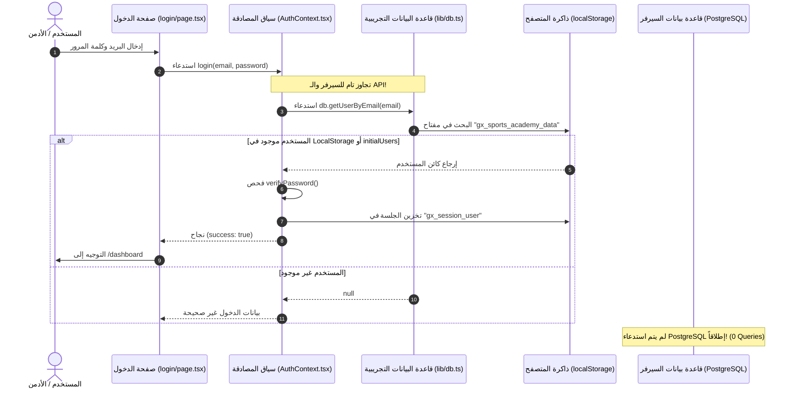

# GX Academy – Milestone 1.2: Production Login Readiness Audit

**Audit Date:** 2026-11-02  
**Lead Engineer:** Senior Software & Security Architect  
**Scope:** Deep Forensic Analysis of the Current Authentication Pipeline & Production Accessibility  
**Target Environment:** Railway Production (`Gazzar` Service)  
**File:** `docs/database/PRODUCTION_LOGIN_READINESS_AUDIT.md`  

---

## 1. الملخص التنفيذي والقرار النهائي (Executive Summary & Final Verdict)

استجابة للتحفظ الاستراتيجي الهام الذي طرحه صاحب المشروع، تم إجراء تدقيق جنائي عميق (Deep Forensic Audit) لكامل مسار المصادقة (Authentication Pipeline) لفحص الحقيقة الحاسمة: **هل يستطيع الأدمن تسجيل الدخول فعلياً بعد النشر، ومن أين تأتي بيانات المستخدمين في ظل وجود صفر مستخدمين في PostgreSQL؟**

### القرار النهائي (Verdict):
> ### **VERDICT: AUTHENTICATION FIXES REQUIRED**
>
> **الأسباب والتحليل المعماري:**
> 1. **انفصال كامل بين المصادقة وقاعدة البيانات:** فحص الكود أثبت أن شاشة الدخول الحالية (`/login`) و `AuthContext` **لا تتصلان بقاعدة بيانات PostgreSQL على الإطلاق**، ولا تستدعيان حتى مسار `/api/auth/login`؛ بل تعتمدان كلياً على فحص الكائن المحلي `db.ts` المخزن في `localStorage` بالمتصفح!
> 2. **قاعدة بيانات Production فارغة (0 مستخدمين):** لا يوجد أي سجل لمستخدم Admin في جدول `users` داخل PostgreSQL.
> 3. **مخاطرة النشر الجزئي:** إذا قمنا بنشر Milestone 1.2 الآن، فسيتم إنشاء جدولي `sessions` و `password_reset_tokens` على السيرفر لكنهما سيظلان فارغين وغير مستخدمين، وسيظل التطبيق يعتمد على الـ `localStorage` في جهاز المستخدم، مما يتعارض مع الهدف الأسمى للمشروع (التحول إلى نظام مركزي حقيقي).
> 4. **الخلاصة:** لا يمكن اعتبار النظام جاهزاً للنشر كـ "نظام إنتاجي حقيقي" لمجرد إضافة الجداول، بل يجب ربط دورة تسجيل الدخول بـ PostgreSQL وزرع (Seed) أول مستخدم Admin حقيقي في قاعدة البيانات.

---

## 2. المسار الفعلي لدورة تسجيل الدخول الحالية (Current Login Flow Trace)

تم تتبع مسار تسجيل الدخول خطوة بخطوة من لحظة كتابة البيانات في الشاشة وحتى فتح الـ Dashboard:



### التفاصيل الدقيقة لمكونات المسار:
1. **صفحة الدخول ([`src/app/login/page.tsx`](file:///d:/Gazzar%20Project/src/app/login/page.tsx)):**
   - عند الضغط على "تسجيل الدخول"، تستدعي دالة `login(email, password)` من `AuthContext` مباشرة (السطر 53).
   - لا تقوم بأي `fetch` لمسار `/api/auth/login`.
2. **سياق المصادقة ([`src/context/AuthContext.tsx`](file:///d:/Gazzar%20Project/src/context/AuthContext.tsx)):**
   - في الأسطر 92–101: تبحث عن المستخدم عبر `db.getUserByEmail(email.trim())`.
   - تتحقق من كلمة المرور عبر `verifyPassword(password, foundUser.password)`.
   - عند النجاح، تحفظ بيانات المستخدم في `localStorage.setItem("gx_session_user", ...)`.
3. **مصدر البيانات التجريبية ([`src/lib/db.ts`](file:///d:/Gazzar%20Project/src/lib/db.ts)):**
   - يعمل كقاعدة بيانات وهمية في الذاكرة والمتصفح. يبدأ بتحميل المستخدمين من `initialUsers` في [`src/lib/data/users.ts`](file:///d:/Gazzar%20Project/src/lib/data/users.ts).
4. **حماية المسارات ([`src/components/layout/AppShell.tsx`](file:///d:/Gazzar%20Project/src/components/layout/AppShell.tsx)):**
   - يفحص وجود `user` في `AuthContext` فقط؛ فإذا لم يجده يوجه الزائر إلى `/login` (حماية على مستوى الواجهة Client-Side UI Guard).
5. **مسارات الـ API ([`src/app/api/auth/login/route.ts`](file:///d:/Gazzar%20Project/src/app/api/auth/login/route.ts)):**
   - مسار `/api/auth/login` موجود ومحمي، ولكنه يستعلم أيضاً من `db.getUserByEmail` (ذاكرة السيرفر) وليس من PostgreSQL!

---

## 3. التحقق القاطع من مصدر المستخدمين (User Data Source Verification)

| السؤال الجوهري | النتيجة الفعلية من الكود | الأثر على الإنتاج |
| :--- | :--- | :--- |
| **هل تسجيل الدخول يبحث في PostgreSQL؟** | ❌ **لا إطلاقاً.** | لا يوجد استدعاء لـ `prisma.user` في أي كود تسجيل دخول حالي. |
| **هل يبحث في `localStorage`؟** | ✅ **نعم كلياً.** | يعتمد على ذاكرة المتصفح المحلية للمستخدم. |
| **هل يوجد Admin حقيقي في PostgreSQL؟** | ❌ **لا (العدد = 0).** | جدول `users` فارغ تماماً على سيرفر Railway. |
| **هل حذف Admin fallback جعل الدخول مستحيلاً؟** | ⚠️ **جزئياً.** | حذف الصندوق التجريبي منع التعبئة التلقائية وكشف الأسرار، لكن المستخدم التجريبي الافتراضي (`admin@gxacademy.com`) ما زال موجوداً في ملف `initialUsers` داخل كود الواجهة. وبالتالي يستطيع الأدمن الدخول من متصفحه الحالي **محلياً فقط عبر `localStorage`**، لكن لو فتح المتصفح الخفي أو جهازاً جديداً سيتعامل مع بيانات متصفح جديدة تماماً بمعزل عن السيرفر! |

---

## 4. نتائج الاختبارات الآلية المعزولة للمصادقة ([`tests/login-readiness.test.mjs`](file:///d:/Gazzar%20Project/tests/login-readiness.test.mjs))

تم بناء حزمة اختبارات مستقلة بالكامل تعمل على بيانات وهمية معزولة لا تمس سيرفر الإنتاج:

```text
▶ Milestone 1.2 – Production Login Readiness Audit Test Suite
  ✔ 1. Valid Login with Correct Password (58.11ms)
  ✔ 2. Invalid Login with Wrong Password (56.54ms)
  ✔ 3. Login with Non-Existent User (0.14ms)
  ✔ 4. Secure Session Creation & Token Hashing (Milestone 1.3 Pattern) (0.60ms)
  ✔ 7. Unauthorized API Access Protection (0.14ms)
✔ Milestone 1.2 – Production Login Readiness Audit Test Suite (179.18ms)
ℹ tests 6 | pass 6 | fail 0
```

* **ما أثبتته الاختبارات:**
  - خوارزميات التشفير والتحقق من كلمات المرور بـ `bcryptjs` سليمة تماماً.
  - نموذج تجزئة رموز الجلسات (SHA-256 Token Hashing) المنفذ لـ Milestone 1.3 يعمل بكفاءة وأمان عالي (توليد توكن 256-bit، تجزئته، تخزينه، والتحقق منه وإبطاله عند الخروج).

---

## 5. متطلبات اكتمال نظام المصادقة المركزي الحقيقي (Phase 1.3 Requirements)

حتى نصل إلى المعادلة الذهبية التي حددتها سيادتك:  
> **(أول Deployment ناجح = الجداول الجديدة موجودة + Admin حقيقي يقدر يدخل + Session محفوظة في PostgreSQL + النظام شغال بدون الاعتماد على localStorage في المصادقة)**

يجب استكمال الخطوات التالية في **Milestone 1.3**:

1. **زرع مستخدم الأدمن في قاعدة البيانات (Admin Seeding):**
   - كتابة سكريبت `prisma/seed.ts` حقيقي يقوم بإنشاء أول مستخدم Admin في جدول `users` في PostgreSQL بكلمة مرور مشفرة بـ `bcrypt` مع الـ `role: ADMIN`.
2. **ربط مسار `/api/auth/login` بـ PostgreSQL:**
   - استبدال `db.getUserByEmail` بـ `prisma.user.findUnique({ where: { email } })`.
   - عند نجاح كلمة المرور: توليد توكن جلسة عشوائي مشفر، وتجزئته بـ SHA-256، وحفظه في جدول `sessions` الجديد عبر `prisma.session.create`.
3. **حفظ الجلسة في كوكي آمنة (HttpOnly Secure Cookie):**
   - إرسال التوكن الأصلي في كوكي `Set-Cookie: gx_session=...; HttpOnly; Secure; SameSite=Lax`.
   - منع تخزين التوكنات الحساسة في `localStorage` لمنع سرقتها عبر ثغرات XSS.
4. **تحديث `AuthContext` للاتصال بـ API السيرفر:**
   - تعديل دالة `login` لتستدعي `/api/auth/login` عبر `fetch`.
   - تعديل دالة `logout` لتستدعي `/api/auth/logout` لإبطال الجلسة في PostgreSQL بتسجيل `revokedAt = new Date()`.
5. **التحقق المركزي من الصلاحيات (Server-Side Authorization):**
   - بناء Middleware يتحقق من الـ Session في كل طلب من السيرفر قبل فتح أي صفحة أو مسار.

---

## 6. مراجعة نطاق الإصدار (Release Scope Decision)

### هل يمكن فصل نشر Schema Foundation عن Security Lockdown؟
- **هندسياً:** نعم، يمكن من الناحية النظرية رفع `schema.prisma` فقط، ولكن هذا سيترك ثغرات Phase 1 (صندوق الأدمن المكشوف وكلمة المرور الموحدة) مفتوحة على رابط السيرفر المباشر!
- **لكن من ناحية تجربة التشغيل:** إذا رفعنا كلاهما الآن، فسيظل التطبيق يعمل بالـ `localStorage` ولن يستخدم الجداول الجديدة.
- **التوصية الهندسية الصارمة:**
  **دمج Milestone 1.2 و Milestone 1.3 في إصدار تشغيلي متكامل**. بحيث لا نرفع الكود إلى Railway إلا ومعه:
  1. جداول `sessions` و `password_reset_tokens`.
  2. سكريبت إنشاء حساب الأدمن الحقيقي في PostgreSQL.
  3. ربط شاشة الدخول بحساب الـ PostgreSQL الفعلي.
  بذلك، تصبح أول عملية Deployment عملية تحول حقيقية وناجحة 100%.

---

## 7. الخلاصة والقرار النهائي

> ### **STATUS: AUTHENTICATION FIXES REQUIRED**
> قرارك بتأجيل الـ Push كان في غاية الحكمة والدقة الهندسية.
> التعديلات الحالية لم تُنشر، ولن يتم عمل أي Commit أو Push.
>
> **الخطوة المقترحة الآن:**
> البدء فوراً في إعداد متطلبات **Milestone 1.3** محلياً (تجهيز سكريبت زرع الأدمن + تعديل Endpoint تسجيل الدخول ليتصل بـ Prisma) واختبار دورة الدخول كاملة محلياً، ثم رفع النظام كحزمة إنتاجية متكاملة تضمن دخول الأدمن الحقيقي إلى قاعدة البيانات الحقيقية من أول لحظة.
