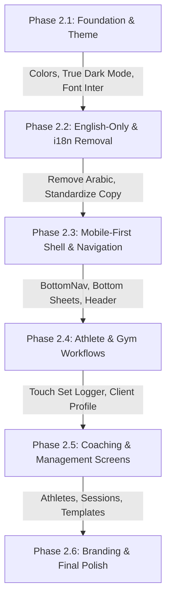

# GX Fitness Academy — Workflow Discovery & Comprehensive UX Audit

**Platform:** GX Fitness Academy (Gazzar Sports Coaching Platform)  
**Document Type:** UX Audit & Workflow Discovery Report  
**Date:** November 2026  
**Status:** Approved Product Direction — Pre-Implementation Discovery  

---

## 1. Executive Summary & Product Alignment

This audit document establishes the comprehensive foundation for the **GX Fitness Academy UI/UX Transformation**.  
Based on approved product decisions, GX Fitness Academy is a dedicated, single-tenant sports academy web application engineered specifically for Coach Abdullah Elgazzar's athletes, coaching staff, and administration.

### Key Product Directives:
1. **Single Academy Focus:** Tailored for GX Fitness Academy operations (not generic SaaS or multi-tenant).
2. **Mobile-First Experience:** 100% of screens, set tracking, modals, and tables designed for handheld touchscreens first.
3. **English Only:** Complete removal of Arabic UI copy in favor of clear, modern, simple English athletic terminology.
4. **True Dual Theme (Dark & Light):** Fixing the current hardcoded light mode lock and delivering an authentic athletic dark mode alongside a crisp light mode.
5. **GX Athletic Branding:** Integrating Coach Abdullah's visual identity, logo, and high-impact athletic styling.
6. **Feature Preservation:** Enhancing and streamlining existing workflows without dropping business functionality.

---

## 2. Inventory of Existing Modules and Pages

The application comprises **21 total pages** across administration, athletic coaching, and trainee self-service:

| Module / Page Route | Primary Roles | Core Purpose | Mobile Status |
| :--- | :---: | :--- | :---: |
| [`/`](file:///d:/Gazzar%20Project/src/app/page.tsx) | All | Root redirect & entry gate to dashboard / login | Pass |
| [`/login`](file:///d:/Gazzar%20Project/src/app/login/page.tsx) | Unauthenticated | Centralized email & password sign-in | Good |
| [`/dashboard`](file:///d:/Gazzar%20Project/src/app/dashboard/page.tsx) | All Roles | Role-adaptive executive / athlete dashboard | Fair |
| [`/clients`](file:///d:/Gazzar%20Project/src/app/clients/page.tsx) | ADMIN, HEAD_COACH, COACH | Athlete directory, status tracking, coach assignment | High Friction |
| [`/clients/[id]`](file:///d:/Gazzar%20Project/src/app/clients/[id]/page.tsx) | All (Scoped) | Athlete 360° profile, medical alerts, measurements, photos | High Friction |
| [`/coaches`](file:///d:/Gazzar%20Project/src/app/coaches/page.tsx) | ADMIN, HEAD_COACH | Coaching staff hierarchy, subordinates, specialties | Medium Friction |
| [`/users`](file:///d:/Gazzar%20Project/src/app/users/page.tsx) | ADMIN, HEAD_COACH | System users, role administration, security resets | High Friction |
| [`/exercises`](file:///d:/Gazzar%20Project/src/app/exercises/page.tsx) | ADMIN, HEAD_COACH, COACH | Exercise library, video demos, muscle targets, cues | Medium Friction |
| [`/templates`](file:///d:/Gazzar%20Project/src/app/templates/page.tsx) | ADMIN, HEAD_COACH, COACH | Workout template builder, sets/reps scheme design | High Friction |
| [`/programs`](file:///d:/Gazzar%20Project/src/app/programs/page.tsx) | ADMIN, HEAD_COACH, COACH | Multi-week training periodization & assignment | Critical Friction |
| [`/assignments`](file:///d:/Gazzar%20Project/src/app/assignments/page.tsx) | All Roles | Daily assigned workouts & scheduled sessions | Medium Friction |
| [`/workout/[id]/execute`](file:///d:/Gazzar%20Project/src/app/workout/[id]/execute/page.tsx) | COACH, CLIENT | Live in-gym workout execution, stopwatch & set logger | Critical Friction |
| [`/calendar`](file:///d:/Gazzar%20Project/src/app/calendar/page.tsx) | ADMIN, HEAD_COACH, COACH | Session scheduling, PT booking, group class calendar | High Friction |
| [`/attendance`](file:///d:/Gazzar%20Project/src/app/attendance/page.tsx) | ADMIN, HEAD_COACH, COACH | Check-in, late tracking, excused absences | High Friction |
| [`/assessments`](file:///d:/Gazzar%20Project/src/app/assessments/page.tsx) | All Roles | Fitness testing (Push-ups, VO2 Max, plank, flexibility) | Medium Friction |
| [`/nutrition`](file:///d:/Gazzar%20Project/src/app/nutrition/page.tsx) | All Roles | Macro targets, meal plans, daily water tracker | Medium Friction |
| [`/memberships`](file:///d:/Gazzar%20Project/src/app/memberships/page.tsx) | All Roles | Packages, subscription tracking, renewal dates | High Friction |
| [`/sports`](file:///d:/Gazzar%20Project/src/app/sports/page.tsx) | ADMIN, HEAD_COACH, COACH | Sports disciplines directory (Bodybuilding, CrossFit, Padel) | Good |
| [`/reports`](file:///d:/Gazzar%20Project/src/app/reports/page.tsx) | ADMIN, HEAD_COACH | Executive charts, attendance trends, revenue metrics | High Friction |
| [`/audit-logs`](file:///d:/Gazzar%20Project/src/app/audit-logs/page.tsx) | ADMIN | System audit trail & administrative security logs | High Friction |
| [`/settings`](file:///d:/Gazzar%20Project/src/app/settings/page.tsx) | All Roles | Theme toggle, units (KG/LBS), profile settings | Fair |

---

## 3. User Journeys by Role

### 3.1. CLIENT (Athlete / Trainee)
* **Primary Persona:** An athlete training under Captain Abdullah or staff coaches, using their smartphone on the gym floor or at home.
* **Core Journey:**
  1. **Morning Check:** Opens app -> Auto-restores session -> Lands on mobile Overview -> Views today's assigned workout, daily calorie/water target, and active subscription days left.
  2. **Gym Floor Execution:** Taps **"Start Workout"** -> Enters `/workout/[id]/execute` -> Starts duration timer -> Logs weight lifted and reps completed set-by-set -> Triggers rest timer -> Rates effort (RPE 1-10) -> Finishes session.
  3. **Nutrition & Hydration:** Logs water glasses on `/nutrition` -> Checks breakfast/lunch/dinner prescribed meal components.
  4. **Progress Review:** Navigates to `/clients/[id]` -> Reviews weigh-in history graph -> Uploads progress photo -> Checks assessment improvements on `/assessments`.

### 3.2. COACH (Staff Trainer / Personal Trainer)
* **Primary Persona:** Coach on the gym floor managing 10–25 athletes, tracking attendances, modifying sets, and recording measurements.
* **Core Journey:**
  1. **Daily Check-In:** Opens `/attendance` -> Sees today's scheduled personal training & group class sessions -> Marks athletes Present, Late, or Absent with single taps.
  2. **Assigning & Customizing Workouts:** Opens `/assignments` or `/clients/[id]` -> Selects an athlete -> Picks workout template -> Adjusts target weights -> Sets scheduled date.
  3. **Supervising Training:** Guides athletes through workouts, notes form adjustments or flags medical restrictions (e.g. knee/shoulder warnings).
  4. **Fitness Assessment:** Conducts monthly physical assessment on `/assessments` -> Enters push-ups, running time, plank, flexibility -> System calculates % improvement.

### 3.3. HEAD_COACH (Captain Abdullah Elgazzar)
* **Primary Persona:** Chief athletic director overseeing all coaches, academy standards, master programs, and high-performance athletes.
* **Core Journey:**
  1. **Academy Overview:** Opens `/dashboard` -> Reviews overall client adherence, active athletes, revenue charts, and coach workloads.
  2. **Coaching Staff Oversight:** Opens `/coaches` -> Reviews subordinate coach rosters, re-assigns athletes to primary/assistant coaches.
  3. **Master Program Design:** Opens `/programs` -> Creates 4-week to 12-week periodized training regimens -> Pushes master programs to multiple athletes.
  4. **Exercise Library Quality:** Curates exercise cues, video demonstrations, and safety contraindications on `/exercises`.

### 3.4. ADMIN (Academy General Management / Operations)
* **Primary Persona:** Academy owner/manager managing memberships, financial renewals, user accounts, and security logs.
* **Core Journey:**
  1. **Member Onboarding:** Opens `/clients` -> Creates new athlete account with contact details and preferred sport.
  2. **Subscription Management:** Opens `/memberships` -> Renews packages, records payment status (Paid, Partial, Unpaid).
  3. **Staff Account Provisioning:** Opens `/users` -> Creates coach logins and assigns roles.
  4. **Governance:** Inspects `/audit-logs` for operational tracking and reviews financial summaries on `/reports`.

---

## 4. Navigation Architecture & Role-Based Access Audit

### Current Structure:
* **Desktop Sidebar ([`src/components/layout/Sidebar.tsx`](file:///d:/Gazzar%20Project/src/components/layout/Sidebar.tsx)):**  
  Displays 16 items for Admin/Coach divided into 4 arbitrary groups (`Core Management`, `Training & Library`, `Operations & Health`, `Reports & Governance`), and 6 items for Clients.
* **Mobile Bottom Bar ([`src/components/layout/BottomNav.tsx`](file:///d:/Gazzar%20Project/src/components/layout/BottomNav.tsx)):**  
  Displays 4 fixed shortcuts plus a generic "More" trigger that slides out the desktop sidebar.
* **Top Header ([`src/components/layout/Navbar.tsx`](file:///d:/Gazzar%20Project/src/components/layout/Navbar.tsx)):**  
  Contains logo, read-only role badge, language toggle (AR/EN), notification bell, and user avatar dropdown with logout.

### Current Friction & Pain Points:
1. **Desktop Sidebar Drawer on Mobile:** Clicking "More" on mobile opens a desktop-style sidebar overlay with 16 dense links, many requiring vertical scrolling on small screens.
2. **Duplicated & Competing Navigation:** Athletes have their profile split between `/dashboard`, `/clients/[id]`, `/assignments`, and `/memberships` without a unified hub.
3. **Information Overload for Coaches:** Staff coaches see all 14 management links when 80% of their day is spent on just 3 screens: **Clients, Workouts, Attendance**.

---

## 5. Friction Analysis & Usability Issues Matrix

The following issues were identified through direct code inspection of every module:

### 5.1. Critical Priority Issues (Must Fix First)

| ID | Module / File | Current Behavior | Why It Creates Friction | Recommended Improvement | Priority |
| :--- | :--- | :--- | :--- | :--- | :---: |
| **UX-01** | **Workout Execute**   [`/workout/[id]/execute/page.tsx`](file:///d:/Gazzar%20Project/src/app/workout/%5Bid%5D/execute/page.tsx#L251) | Set logger table is built with a 12-column grid (`grid-cols-12`). Each input is only ~25-35px wide. | In the gym, athletes cannot accurately tap or edit actual weight and reps on a smartphone. | Redesign into large, touch-friendly exercise cards with stepper buttons (+/- 2.5kg, +/- 1 rep) and a thumb-friendly complete button. | **Critical** |
| **UX-02** | **Dark Mode Broken**  [`globals.css`](file:///d:/Gazzar%20Project/src/app/globals.css#L17) & [`ThemeContext.tsx`](file:///d:/Gazzar%20Project/src/context/ThemeContext.tsx#L19) | Dark mode is hardcoded off in `ThemeContext`, and `globals.css` sets identical light backgrounds for `html.dark` (`#f8fafc`). | GX Academy is an athletic platform; gym environments demand authentic dark mode. Current mixed dark/light classes create contrast bugs. | Enable true athletic Dark Mode (deep zinc/slate `#090d16` background, vibrant emerald `#10b981` accents) with seamless 1-click toggle. | **Critical** |
| **UX-03** | **Language Fragmentation**  [`i18n.ts`](file:///d:/Gazzar%20Project/src/lib/i18n.ts) & all pages | Every screen uses ternary operators (`language === 'ar' ? ... : ...`) and hardcoded Arabic strings, with RTL default. | Clutters code, doubles form inputs (e.g. `nameAr` & `nameEn`), and violates the approved decision for an English-only international platform. | Completely remove Arabic dictionary, remove RTL, set LTR default, and standardize on simple, powerful English athletic terms. | **Critical** |

### 5.2. High Priority Issues

| ID | Module / File | Current Behavior | Why It Creates Friction | Recommended Improvement | Priority |
| :--- | :--- | :--- | :--- | :--- | :---: |
| **UX-04** | **People Management Fragmentation**  [`/users`](file:///d:/Gazzar%20Project/src/app/users/page.tsx), [`/clients`](file:///d:/Gazzar%20Project/src/app/clients/page.tsx), [`/coaches`](file:///d:/Gazzar%20Project/src/app/coaches/page.tsx) | Staff and athletes are managed in 3 disconnected pages. Admin can add a coach from `/users` or `/coaches`, and an athlete from `/users` or `/clients`. | Confusion over where to perform onboarding, role changes, and profile edits. | Unify people management into a clean **Athletes** directory and a **Coaching Staff** directory, with administrative user role controls embedded directly. | **High** |
| **UX-05** | **Mobile Table Overflows**  [`/memberships/page.tsx`](file:///d:/Gazzar%20Project/src/app/memberships/page.tsx#L80), [`/attendance/page.tsx`](file:///d:/Gazzar%20Project/src/app/attendance/page.tsx#L70) | Relies on 7-column HTML tables with `overflow-x-auto`. | Athletes and coaches must horizontally scroll on phones to see payment status, dates, or check-in buttons. | Replace wide tables on mobile with responsive **Card Stacks** displaying key badge metrics and touch actions. | **High** |
| **UX-06** | **Calendar Lacks Interactive Date Grid**  [`/calendar/page.tsx`](file:///d:/Gazzar%20Project/src/app/calendar/page.tsx#L45) | Renders all session cards in a static vertical list without date filtering or week-view navigation. | Users cannot view sessions for "Today", "Tomorrow", or jump to a specific date on their calendar. | Implement a responsive 7-day horizontal date slider ("Today", "Tue 4", "Wed 5", etc.) with quick Day/Week toggle. | **High** |
| **UX-07** | **Program Periodization on Mobile**  [`/programs/page.tsx`](file:///d:/Gazzar%20Project/src/app/programs/page.tsx#L60) | Creating a multi-week program requires editing up to 56 days inside a complex modal with dozens of nested inputs. | Form overflows mobile screens, making program design on a phone frustrating and error-prone. | Provide a clean accordion-based week builder where coaches can duplicate weeks and tap-assign existing templates in 2 clicks. | **High** |

### 5.3. Medium Priority Issues

| ID | Module / File | Current Behavior | Why It Creates Friction | Recommended Improvement | Priority |
| :--- | :--- | :--- | :--- | :--- | :---: |
| **UX-08** | **Dual Workout Assignment Flow**  [`/templates/page.tsx`](file:///d:/Gazzar%20Project/src/app/templates/page.tsx#L50) vs [`/assignments/page.tsx`](file:///d:/Gazzar%20Project/src/app/assignments/page.tsx#L74) | "Assign to Client" exists both as a modal in Templates and as a dedicated page in Assignments. | Coaches are unsure whether to assign from the Template library or the Assignments page. | Consolidate assignment action: allow 1-click assign from template details, and focus `/assignments` on scheduled athlete calendar queue. | **Medium** |
| **UX-09** | **Mobile Filters Clutter**  [`/clients/page.tsx`](file:///d:/Gazzar%20Project/src/app/clients/page.tsx#L240), [`/exercises/page.tsx`](file:///d:/Gazzar%20Project/src/app/exercises/page.tsx#L33) | 3 to 4 full-width dropdown selects stack vertically on mobile, taking up half the screen before any content is visible. | Pushes actual athlete or exercise cards below the fold. | Use a compact horizontal scrollable filter pill bar (`All`, `Active`, `Leads`, etc.) with a single "Filters" bottom sheet for advanced queries. | **Medium** |
| **UX-10** | **Dual-Language Form Bloat**  [`/exercises/page.tsx`](file:///d:/Gazzar%20Project/src/app/exercises/page.tsx#L52), [`/sports/page.tsx`](file:///d:/Gazzar%20Project/src/app/sports/page.tsx#L38) | Forms require `nameAr`, `nameEn`, `descAr`, `descEn`, `instAr`, `instEn`. | Doubles form completion time and requires bilingual input for every new exercise or template. | Simplify forms to standard single English fields: `Name`, `Target Muscles`, `Equipment`, `Instructions`, `Coaching Tips`. | **Medium** |
| **UX-11** | **Attendance Date Picker Missing**  [`/attendance/page.tsx`](file:///d:/Gazzar%20Project/src/app/attendance/page.tsx#L51) | Shows all calendar sessions without filtering by date. | A coach standing at the reception needs to see ONLY today's sessions, not last week's or next month's. | Default to **Today's Sessions** with a quick date switch bar. | **Medium** |

### 5.4. Low Priority Issues

| ID | Module / File | Current Behavior | Why It Creates Friction | Recommended Improvement | Priority |
| :--- | :--- | :--- | :--- | :--- | :---: |
| **UX-12** | **Settings Demo Reset Button**  [`/settings/page.tsx`](file:///d:/Gazzar%20Project/src/app/settings/page.tsx#L195) | Shows "Reset all data to default demo state" button calling `db.resetToDefaults()`. | Prototype artifact that can confuse users in a production coaching platform. | Remove the demo reset button from settings. | **Low** |
| **UX-13** | **Navbar Role Badge Redundancy**  [`/Navbar.tsx`](file:///d:/Gazzar%20Project/src/components/layout/Navbar.tsx#L81) | Read-only colored badge in top navbar takes up valuable horizontal space on mobile. | Clutters navbar alongside brand and notifications. | Move role badge inside the User Profile drawer / dropdown menu. | **Low** |

---

## 6. Proposed Simplified Navigation Architecture

To achieve a true **Mobile-First Athletic Experience**, we propose streamlining navigation for each role:

### 6.1. CLIENT (Athlete Hub)
* **Bottom Navigation Bar (Always Visible on Mobile):**
  1. 🏠 **Today** (`/dashboard`): Today's assigned workout, calories/water summary, quick stats.
  2. 🏋️ **Workouts** (`/assignments`): Scheduled workouts, live workout launcher, exercise history.
  3. 🥗 **Nutrition** (`/nutrition`): Meal plan, macro targets, water tracker.
  4. 📈 **Progress** (`/clients/[id]`): Body stats, weight graph, photos, fitness assessments.
  5. 👤 **Profile** (`/settings`): Membership status, theme toggle, account settings, logout.

### 6.2. COACH (Trainer Gym Floor Toolkit)
* **Bottom Navigation Bar (Mobile):**
  1. 🏠 **Overview** (`/dashboard`): Today's schedule, active athletes, attendance summary.
  2. 👥 **Athletes** (`/clients`): Athlete roster, medical alerts, assigned programs, quick stats.
  3. 📋 **Sessions** (`/attendance`): Today's check-ins, PT & class roster management.
  4. 🏋️ **Workouts** (`/assignments`): Workout assignments, template library (`/templates`), exercise library (`/exercises`).
  5. ⋯ **More** (Bottom Sheet): Calendar (`/calendar`), Assessments (`/assessments`), Nutrition plans (`/nutrition`), Settings.

### 6.3. HEAD_COACH & ADMIN (Executive Management)
* **Bottom Navigation Bar (Mobile) & Sidebar (Desktop):**
  1. 🏠 **Dashboard** (`/dashboard`): Comprehensive analytics, retention, athlete counts, coach workload.
  2. 👥 **Athletes** (`/clients`): Full athlete lifecycle management, medical alerts, coach assignments.
  3. 🛡️ **Coaches** (`/coaches`): Coaching staff hierarchy, specialty assignments, performance.
  4. 🏋️ **Library** (`/templates` & `/exercises`): Master workout templates, multi-week programs (`/programs`), sports catalog.
  5. 💳 **Memberships** (`/memberships`): Subscription packages, payment tracking, renewals.
  6. ⋯ **More / Admin** (`/reports`, `/audit-logs`, `/users`, `/settings`): Analytics, security logs, system settings.

---

## 7. English Terminology Standardization Guide

The entire user interface will be translated to concise, professional English athletic terms. Below is the master mapping:

| Old Arabic Term / Current Mixed Copy | Standard English Athletic Term | Context / Usage |
| :--- | :--- | :--- |
| لوحة التحكم / لوحة المتدرب | **Dashboard** / **Overview** | Main navigation & home screen |
| المشتركون / المتدربين | **Athletes** | Client roster & trainee profiles |
| الكباتن / المدربين | **Coaches** | Coaching staff directory |
| جدول تماريني / تعيين التمارين | **Workouts** / **Assignments** | Workout scheduling & execution |
| بدء التمرين الآن / تنفيذ التمرين | **Start Workout** / **Execute** | Live gym floor workout logger |
| الجولة / المطلوب / الفعلي | **Set** / **Target** / **Actual** | Set logging rows |
| وقت الراحة | **Rest Timer** | Inter-set rest countdown |
| التقييمات البدنية | **Assessments** | Physical fitness testing |
| الأنظمة الغذائية / خطتي الغذائية | **Nutrition** / **Meal Plans** | Dietary targets & meal plans |
| الاشتراكات والعضويات | **Memberships** | Subscriptions & packages |
| دليل الرياضات | **Sports Directory** | Athletic disciplines (CrossFit, etc.) |
| مكتبة التمارين | **Exercise Library** | Exercise catalog & video cues |
| قوالب التمارين | **Workout Templates** | Pre-built workout routines |
| البرامج التدريبية | **Training Programs** | Multi-week periodized plans |
| الحضور والغياب | **Attendance** | Check-ins & session adherence |
| حاضر / غائب / متأخر / معذور | **Present** / **Absent** / **Late** / **Excused** | Attendance check-in buttons |
| سجل القياسات والأوزان | **Body Measurements** | Weight, body fat, circumferences |
| السجل الطبي ومحاذير الإصابات | **Medical Alerts** | Injury flags & contraindicated exercises |
| تقارير وإحصائيات | **Analytics & Reports** | Financial & performance metrics |
| سجل التدقيق والرقابة | **Audit Logs** | Security & change history |
| الوضع الليلي / الفاتح | **Dark Mode** / **Light Mode** | Theme selection |

---

## 8. Reusable Component Inventory for Transformation

The following existing components are structurally sound and can be upgraded for the Mobile-First / English-Only transformation:

1. **[`src/components/layout/Navbar.tsx`](file:///d:/Gazzar%20Project/src/components/layout/Navbar.tsx):**  
   - Header container, brand styling, notification icon, avatar dropdown.
   - Refactor: Remove Arabic toggle button, clean up mobile spacing.
2. **[`src/components/layout/BottomNav.tsx`](file:///d:/Gazzar%20Project/src/components/layout/BottomNav.tsx):**  
   - Mobile bottom navigation shell, active link highlighting, central primary action button.
   - Refactor: Apply updated role-based 5-item tabs and replace slideout drawer with a modern mobile bottom sheet.
3. **[`src/components/layout/AppShell.tsx`](file:///d:/Gazzar%20Project/src/components/layout/AppShell.tsx):**  
   - Layout wrapper, client route navigation protection, responsive padding.
   - Refactor: Ensure clean full-height container with zero desktop-only constraints.
4. **Metric & Stat Badges (across multiple pages):**  
   - Pill badges for status (`ACTIVE`, `LEAD`, `EXPIRED`) and difficulty (`BEGINNER`, `INTERMEDIATE`, `ADVANCED`).
5. **Recharts Charts Containers (in `/dashboard` & `/reports`):**  
   - Responsive containers for weight progression, attendance rates, and volume tracking.

---

## 9. Implementation Roadmap & Next Steps

Following this discovery audit, the UI/UX transformation will proceed in orderly, verified phases:

1. **Phase 2.1 — Theme & Color Foundation:**  
   Configure true Dark & Light mode in `globals.css` and `ThemeContext`, applying GX athletic colors (Deep Onyx `#090d16`, Emerald `#10b981`, Athletic Amber `#f59e0b`) and modern English typography (`Inter`).
2. **Phase 2.2 — English-Only Localization:**  
   Remove bilingual ternaries across components, purge Arabic translation keys, and establish clean English copy throughout.
3. **Phase 2.3 — Mobile-First Shell & Navigation:**  
   Upgrade `BottomNav`, `Sidebar`, and `Navbar` into responsive role-based hubs with mobile bottom drawers.
4. **Phase 2.4 — Athlete & In-Gym Workflows:**  
   Redesign `/workout/[id]/execute` into a world-class mobile workout tracker with large tap steppers, rest timers, and exercise cues.
5. **Phase 2.5 — Coaching & Management Redesign:**  
   Streamline `/clients`, `/attendance`, `/templates`, and `/calendar` for rapid gym-floor operations.
6. **Phase 2.6 — GX Visual Branding:**  
   Integrate Coach Abdullah Elgazzar's branding assets, logo, and photography.

---

> [!NOTE]
> **Safety Compliance:** No application source code, database tables, or authentication logic were modified during this discovery task. Railway Production was not accessed, and zero git commits were made.
